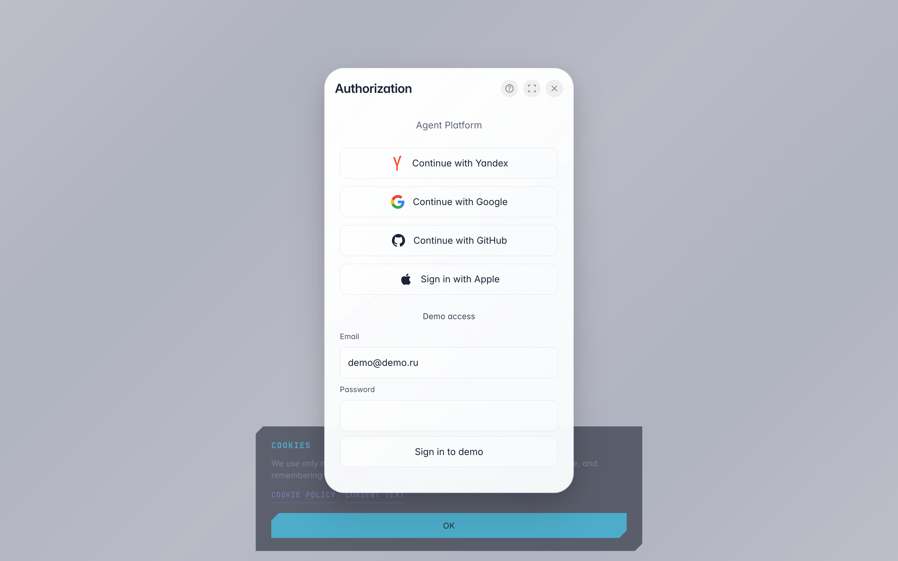

# Войти в платформу

**Для чего:** вход в консоль компании — страница предлагает войти через привычный сервис, без отдельного пароля платформы.

**Какие проблемы решает:** не нужно запоминать ещё один пароль; вход через Яндекс, Google или GitHub занимает пару нажатий.

**Результат:** вы внутри консоли компании — видны проекты, команда и все разделы.

## Шаг 1. Откройте страницу входа

Страница входа предлагает способы авторизации: выберите сервис, которым пользуетесь — Яндекс, Google или GitHub — и подтвердите вход на его стороне. Отдельный пароль платформы не нужен.

## Шаг 2. Выберите способ входа

**Демонстрация результата.** После подтверждения у выбранного сервиса вы сразу попадаете в консоль компании. Приглашение от коллеги приведёт на эту же страницу — достаточно войти, и компания появится сама.

**Итог.** Если вход не удался — проверьте, что в выбранном сервисе вошли под нужной учётной записью, или напишите в поддержку (значок вопроса вверху окна).

