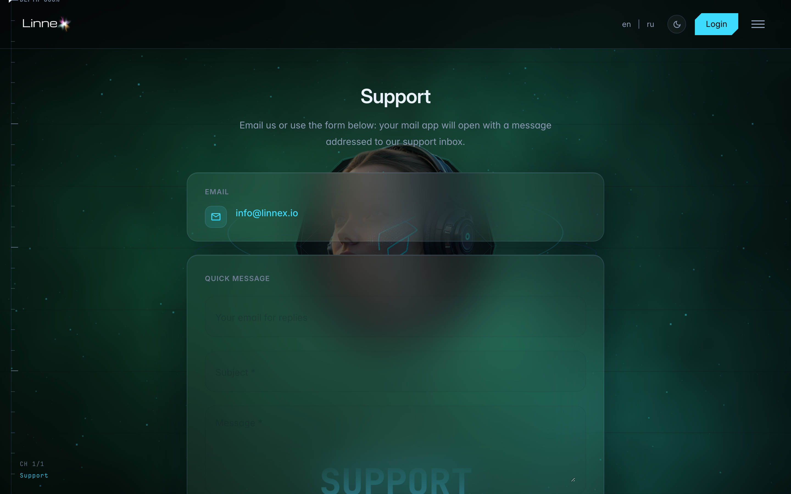
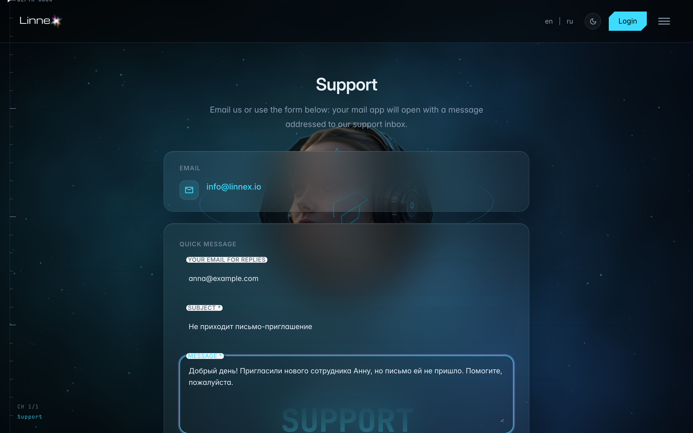

# Contact support

**What for:** the support page helps you ask the platform team — by email or via the form.

**Problems solved:** no need to hunt for contacts: the address and the form are on one page, reachable even without signing in.

**Result:** you know where to write with questions and issues — the form opens a letter in your mail app.

## Step 1. Open the support page

The support page is reachable by a direct link even without signing in to the console. The team email is on top, the contact form below.

## Step 2. Fill in the contact form

**Result demonstration.** Enter your reply email, subject and describe the issue — the submit button opens a ready-made letter in your mail app, just press Send.

**Summary.** The fastest path is the support address at the top of the page; the form makes sure nothing is missed.

