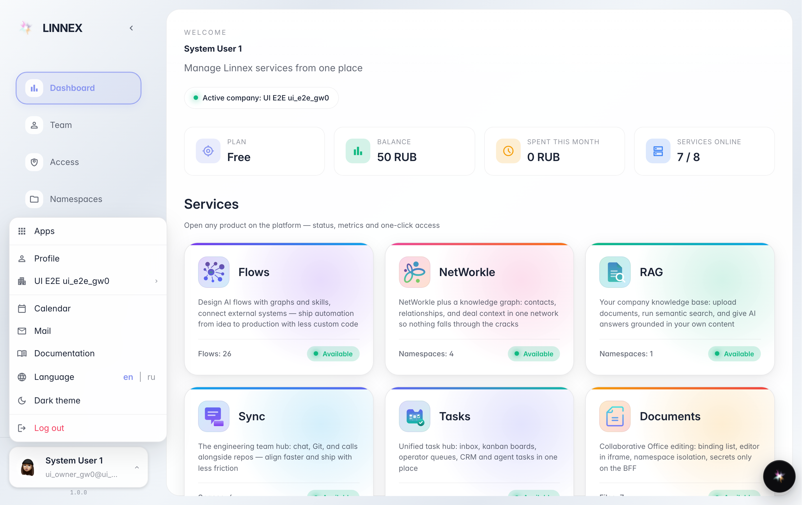
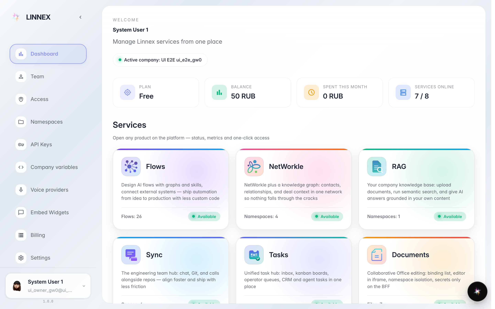

# Account menu: theme, language and sign-out

**What for:** the account menu at the bottom left gathers personal preferences: theme, interface language, documentation and sign-out.

**Problems solved:** no need to hunt settings across sections — dark theme and English are two clicks away.

**Result:** the interface looks and speaks the way you like.

## Step 1. Open the account menu

Click your name at the bottom left: profile, company list, mail, calendar, documentation, language, theme and sign-out live here.

## Step 2. Switch on the dark theme

The Dark theme item re-skins the whole console — easier on the eyes in the evening. Click again to go back to light.

## Step 3. Switch the interface language

The en|ru buttons in the Language row translate the menu and the interface. The choice is remembered — the console opens in it next time.

**Summary.** Theme and language are personal: they do not affect your colleagues.

