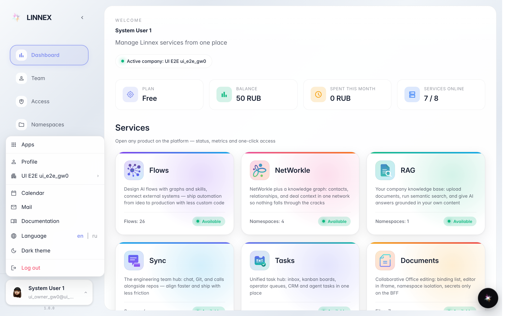
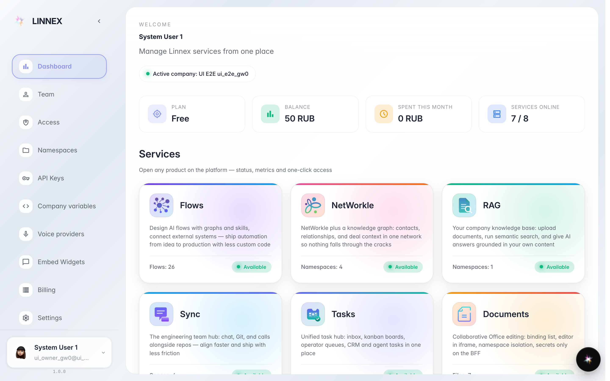

# Меню аккаунта: тема, язык и выход

**Для чего:** меню аккаунта внизу слева собирает личные настройки: сменить тему, язык интерфейса, открыть документацию или выйти.

**Какие проблемы решает:** не нужно искать настройки по разделам — тёмная тема и английский язык включаются в два клика.

**Результат:** интерфейс выглядит и говорит так, как удобно вам.

## Шаг 1. Откройте меню аккаунта

Нажмите на своё имя внизу слева: здесь профиль, список компаний, почта, календарь, документация, язык, тема и выход из аккаунта.

## Шаг 2. Включите тёмную тему

Пункт «Тёмная тема» переключает оформление всей консоли — привычнее работать вечером. Повторный клик возвращает светлую.

## Шаг 3. Переключите язык интерфейса

Кнопки en|ru в строке «Language» переводят меню и интерфейс. Язык запоминается — при следующем входе консоль уже на нём.

**Итог.** Тема и язык — личные настройки: на других сотрудников они не влияют.

