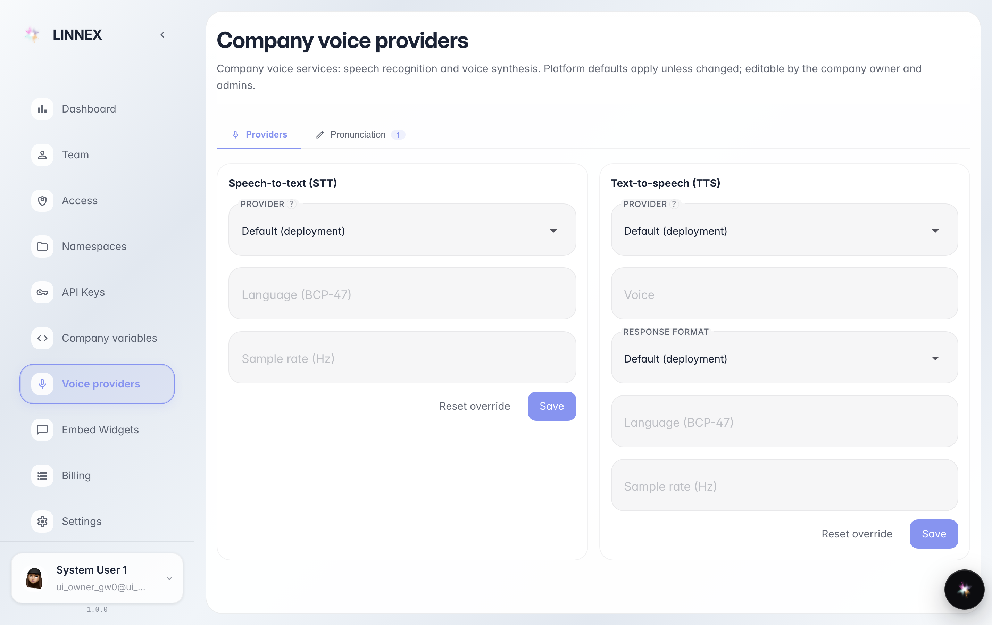
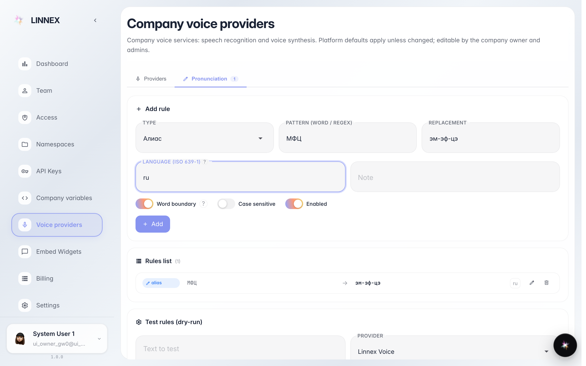
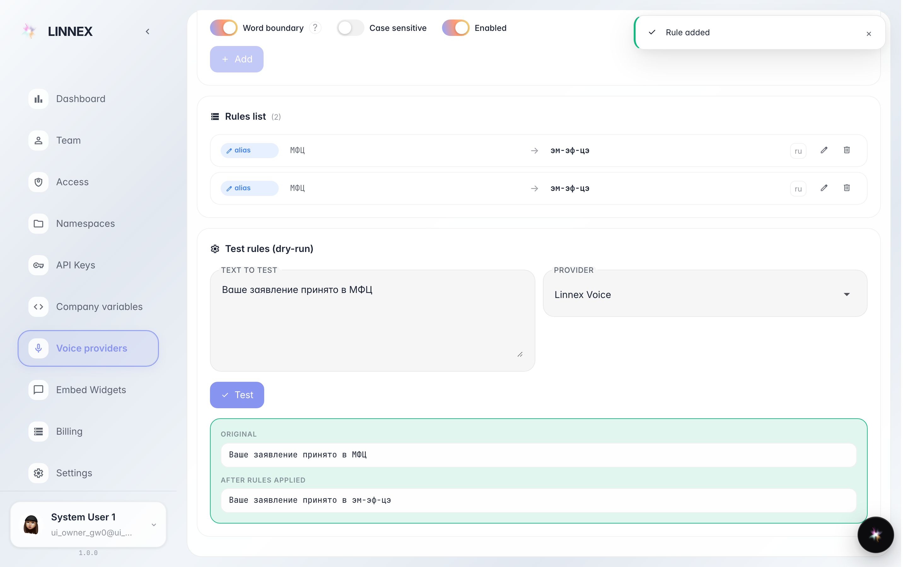

# Set up voice providers and pronunciation

**Purpose:** the «Voice providers» page picks which services the company uses for speech recognition and synthesis, and the «Pronunciation» tab teaches the agent how to say your words — abbreviations, names, terms.

**Problems solved:** the agent misreads «LLC» or your company name; a region needs a different voice service.

**Result:** a pronunciation rule added and tested on real text — you can see how the phrase will sound.

## Step 1. Open «Voice providers»

Two cards: «Speech recognition» (hears the customer) and «Speech synthesis» (the voice the agent answers with). Platform defaults work out of the box — change them only if your company needs its own service.

## Step 2. Add a pronunciation rule

On the «Pronunciation» tab write which word to replace and with what: e.g. «LLC» → «ell-ell-cee» so the agent spells the abbreviation. The «Language» field limits the rule to one language (ru, en) — leave empty for all.

## Step 3. Test the rule on real text

**Result demonstration.** The rule is now listed, and the «Rule check» block shows before and after: «Ваше заявление принято в МФЦ» → «…в эм-эф-цэ». That is exactly how the phrase will sound to the customer.

**Summary.** The dictionary applies to all company voice replies; a rule can be edited or removed in the list.

