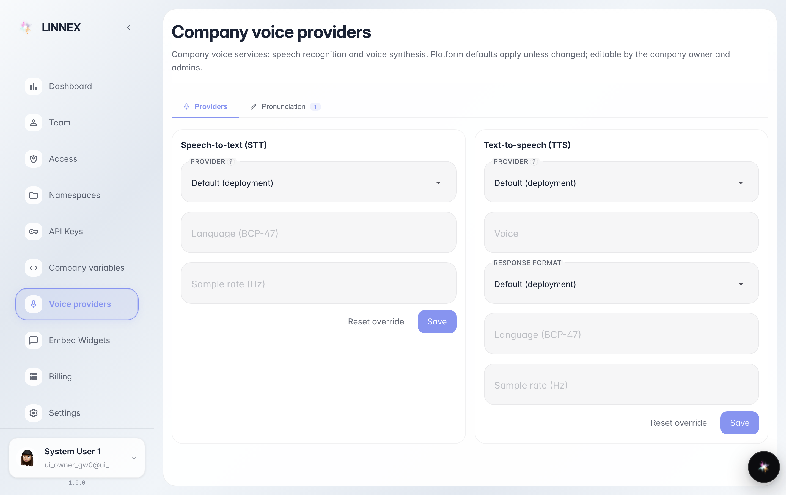
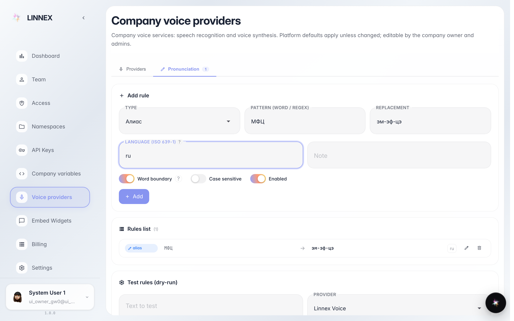
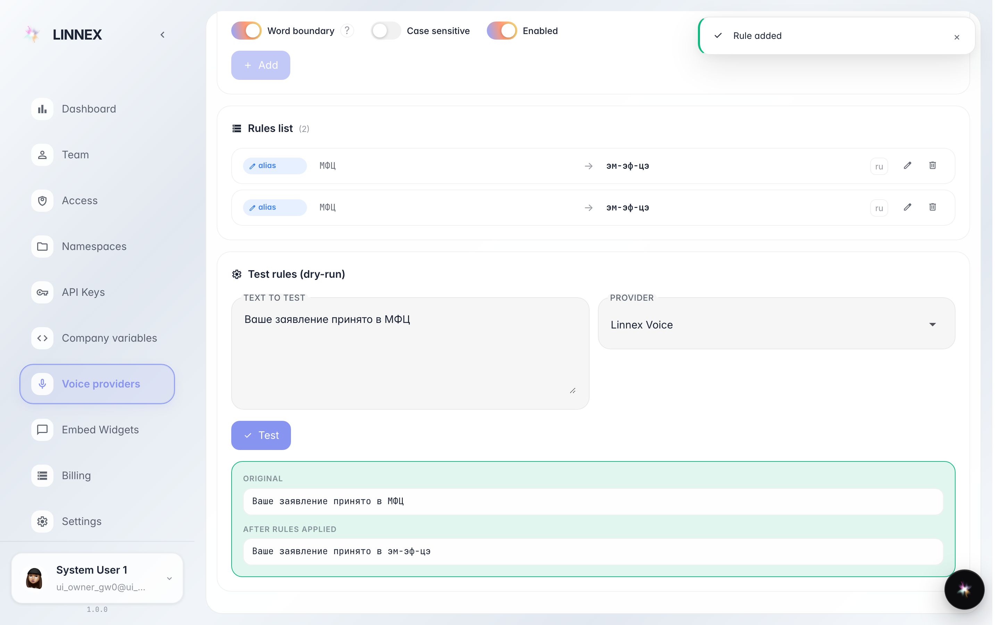

# Настроить голос и произношение

**Для чего:** страница «Провайдеры речи» выбирает, какими сервисами компания распознаёт и озвучивает речь, а вкладка «Произношение» учит агента правильно говорить ваши слова — аббревиатуры, названия, термины.

**Какие проблемы решает:** агент неправильно читает «МФЦ» или название компании; для региона нужен другой голосовой сервис.

**Результат:** добавлено правило произношения и проверено на реальном тексте — видно, как фраза прозвучит.

## Шаг 1. Откройте «Провайдеры речи»

Две карточки: «Распознавание речи» (слышит клиента) и «Синтез речи» (каким голосом отвечает агент). По умолчанию работают настройки платформы — менять нужно, только если компании требуется свой сервис.

## Шаг 2. Добавьте правило произношения

На вкладке «Произношение» напишите, какое слово подменять и на что: например «МФЦ» → «эм-эф-цэ», чтобы агент читал аббревиатуру по буквам. Поле «Язык» ограничивает правило одним языком (ru, en) — оставьте пустым для всех.

## Шаг 3. Проверьте правило на тексте

**Демонстрация результата.** Правило появилось в списке, а блок «Проверка правил» показывает до и после: «Ваше заявление принято в МФЦ» → «…в эм-эф-цэ». Именно так фраза прозвучит для клиента.

**Итог.** Словарь применяется ко всем голосовым ответам компании; правило можно изменить или удалить в списке.

