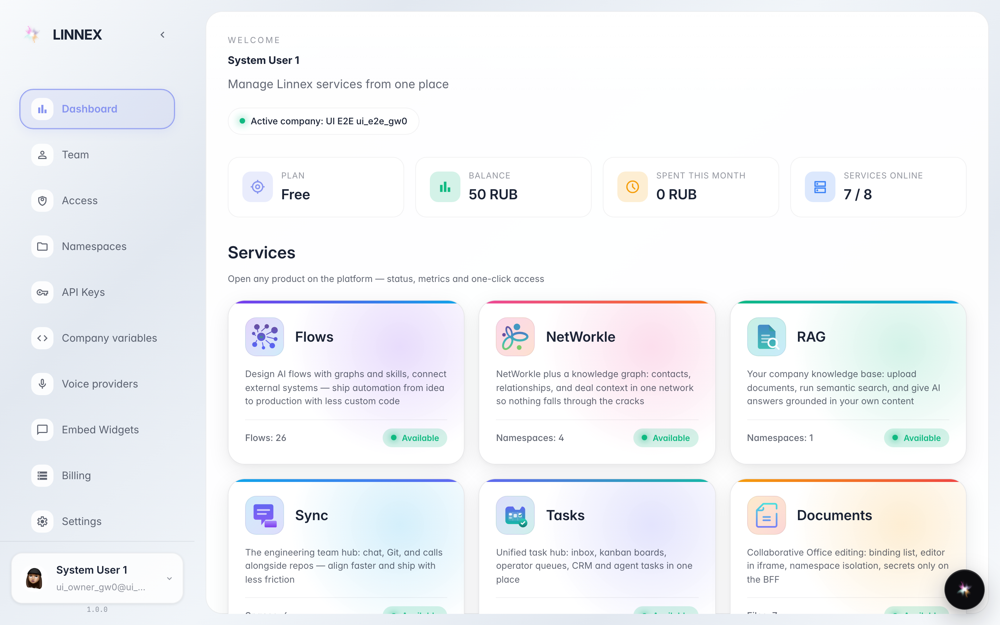
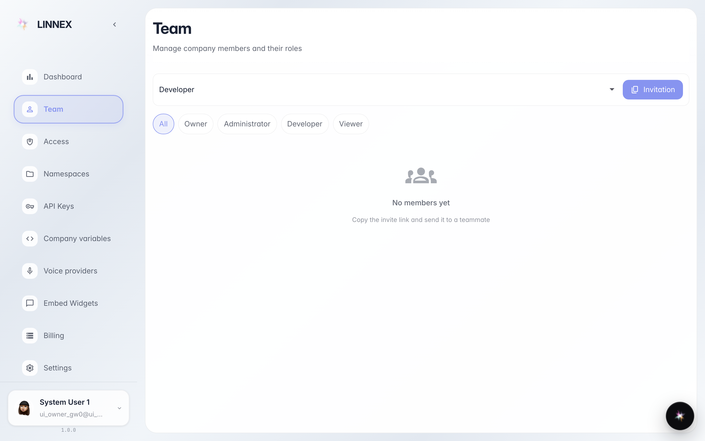

# First look at the console: dashboard, team, apps

**Purpose:** your first sign-in to the company workspace — learn in five minutes where things are and where to start.

**Problems solved:** you will know what the dashboard shows, where the colleagues list lives, and where the company app catalog is — shop, warehouse, chats, documents and more.

**Result:** you can navigate the console and open the app you need.

## Step 1. Open the console — the dashboard

After sign-in you land on the dashboard — the company's main screen. On top are a greeting and a summary, below are cards of all apps available to the company and a quick-actions bar.

## Step 2. See the Team page

The «Team» section lists all company members: who works here, their roles and permissions. New colleagues are also invited from here via a link.

## Step 3. Find the app you need in the catalog

Back on the dashboard: the tiles are the company's apps. Chat, documents, knowledge base, shop, warehouse — each tile opens its own section. Click the one you need to start working.

## Step 4. Remember the quick-actions bar

**Result demonstration.** At the bottom of the dashboard are quick actions: the most common tasks are one click away, no menu digging needed.

**Summary.** You know the console map: dashboard — start and app catalog, «Team» — colleagues and invites, quick actions — frequent tasks.

