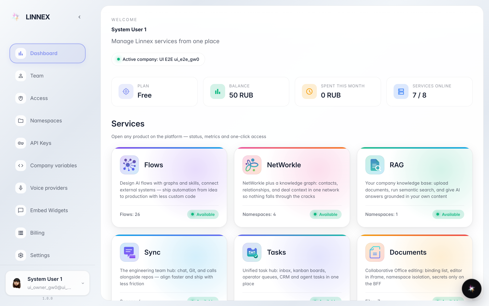
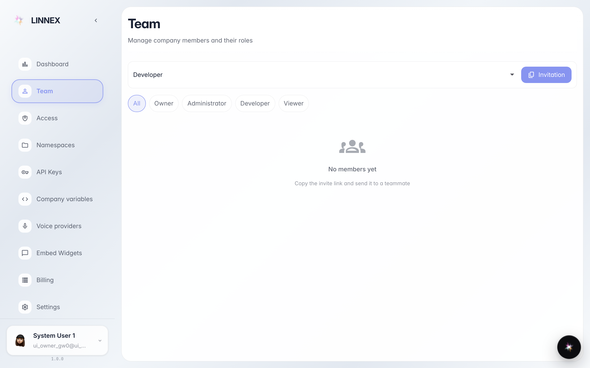

# Первый взгляд на консоль: дашборд, команда, приложения

**Для чего:** первый вход в рабочее место компании — за пять минут понять, где что находится и с чего начать работу.

**Какие проблемы решает:** вы узнаете, что показывает дашборд, где список коллег и где каталог приложений компании — магазин, склад, чаты, документы и другие.

**Результат:** вы ориентируетесь в консоли и знаете, как открыть нужное приложение.

## Шаг 1. Откройте консоль — вы на дашборде

После входа вы попадаете на дашборд — главный экран компании. Сверху приветствие и сводка, ниже — карточки всех приложений, к которым у компании есть доступ, и панель быстрых действий.

## Шаг 2. Посмотрите страницу «Команда»

В разделе «Команда» собраны все сотрудники компании: кто работает, какие у них роли и права. Отсюда же приглашают новых коллег по ссылке.

## Шаг 3. Найдите нужное приложение в каталоге

Вернитесь на дашборд: плитки — это приложения компании. Чат, документы, база знаний, магазин, склад — каждая плитка ведёт в свой раздел. Кликните по нужной, чтобы начать работу.

## Шаг 4. Запомните панель быстрых действий

**Демонстрация результата.** Внизу дашборда — быстрые действия: то, что делают чаще всего, доступно в один клик без поиска по меню.

**Итог.** Вы знаете карту консоли: дашборд — старт и каталог приложений, «Команда» — коллеги и приглашения, быстрые действия — частые задачи.

