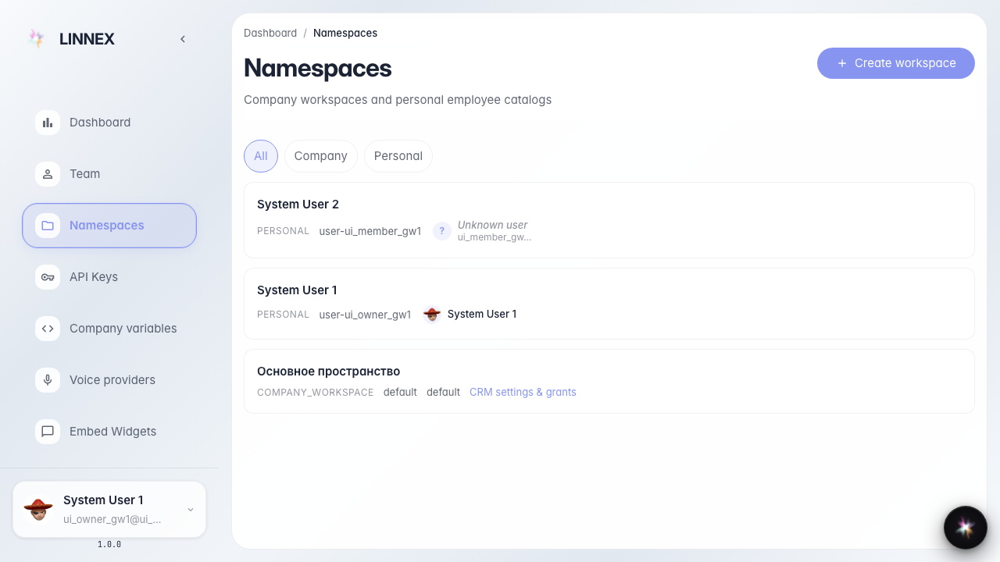
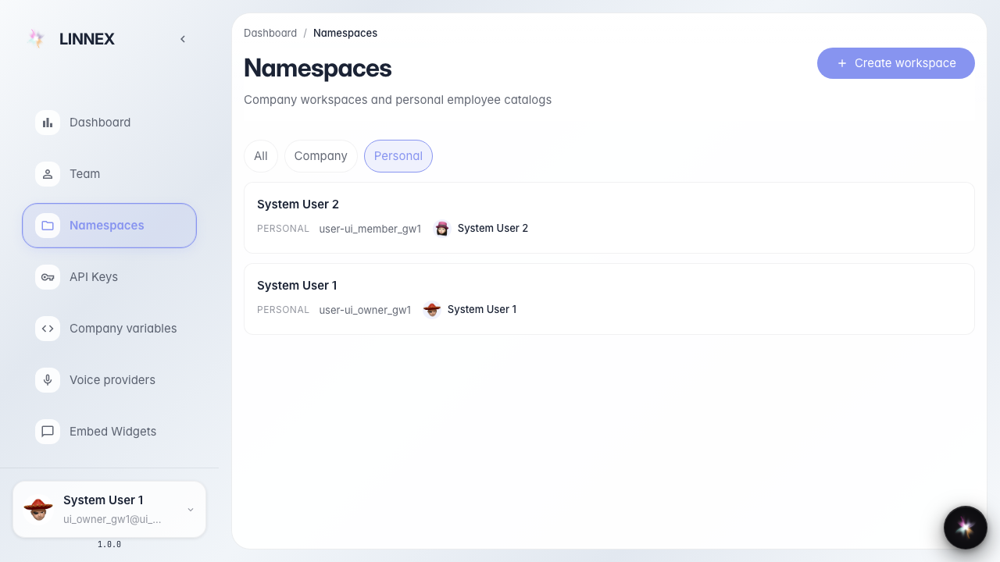
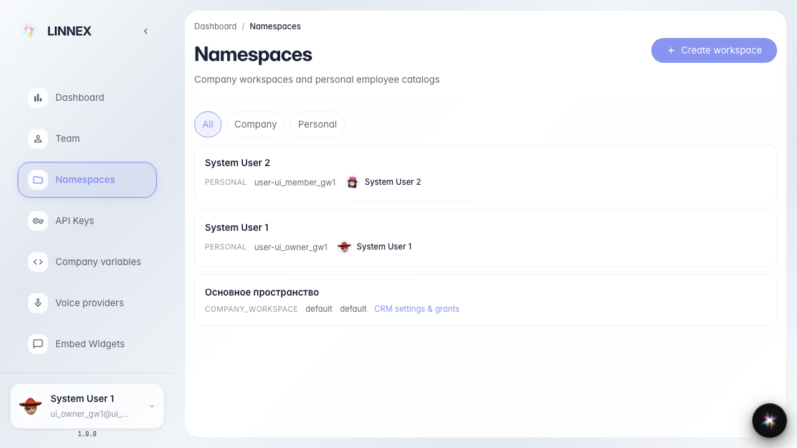
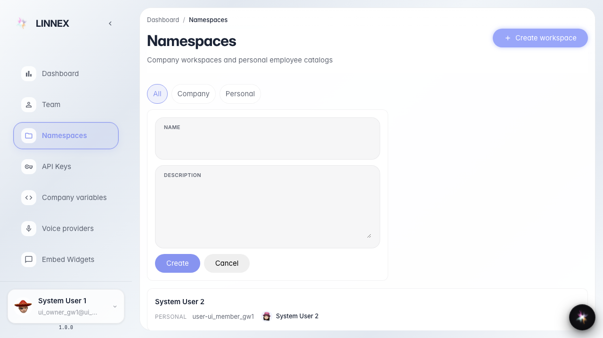
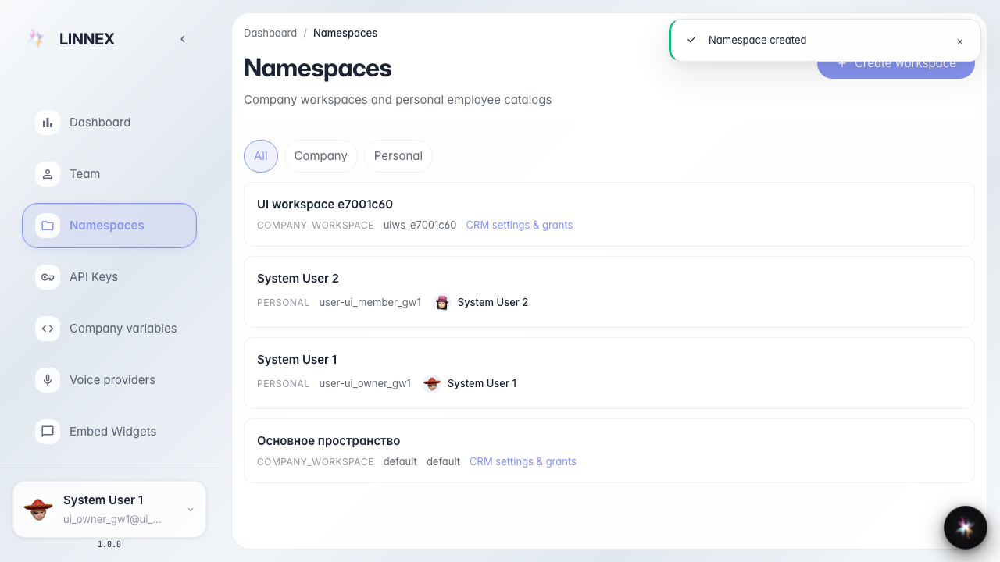

# How to view and create a company namespace

**Purpose:** helps an admin open the company namespaces list in the console and create a lightweight workspace.

**Problems it solves:** you learn where employee and department spaces live, how to filter personal catalogs, and how to add a workspace without a CRM template.

**Result:** the new workspace appears in the list under the name you chose.

## Step 1. Open the namespaces page

В консоли платформы откройте раздел Namespaces (Пространства) в боковом меню или перейдите по адресу /namespaces. Это нужно, чтобы увидеть реестр рабочих и личных пространств компании. На экране появится заголовок страницы и список карточек.

## Step 2. Filter personal namespaces

Нажмите фильтр Personal (Личные). Так вы оставите в списке только именные каталоги сотрудников. Кнопка фильтра подсветится как активная.

## Step 3. Return to the full list

Нажмите фильтр All (Все), чтобы снова увидеть и рабочие пространства компании, и личные каталоги. Это нужно перед созданием нового workspace — иначе карточка нового пространства не появится в текущем отфильтрованном списке.

## Step 4. Open the create workspace form

Нажмите кнопку Create workspace (Создать пространство). Появится форма с полями имени и описания — без выбора CRM-шаблона.

## Step 5. Confirm the new workspace in the list

**Демонстрация результата.** В списке появилась карточка с именем uiws_e7001c60. Рядом видна ссылка на настройки CRM — значит пространство зарегистрировано как рабочее пространство компании.

**Итог.** Теперь вы умеете открыть реестр пространств, отфильтровать личные каталоги и создать лёгкое workspace без CRM-шаблона.

