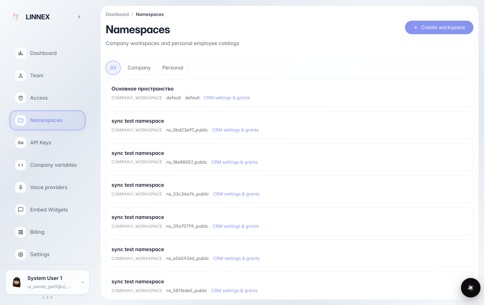
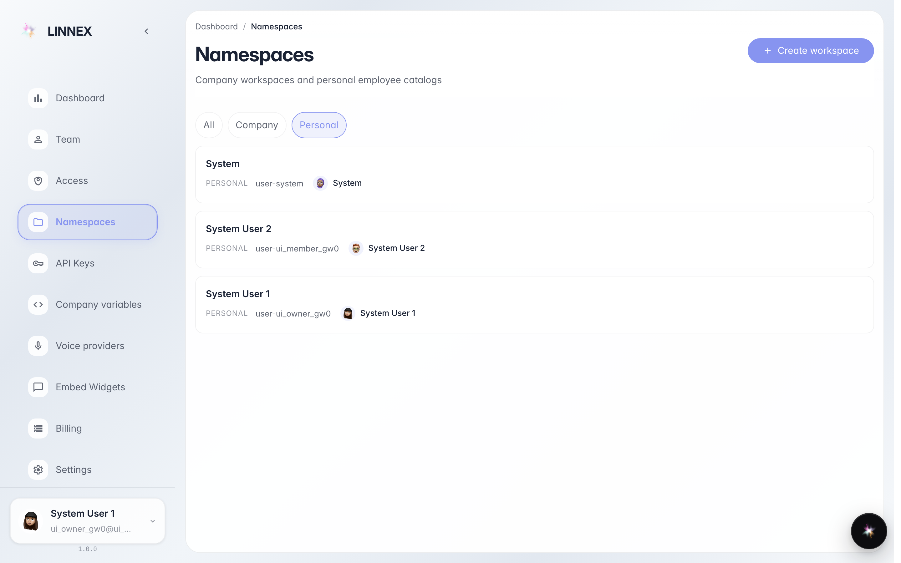
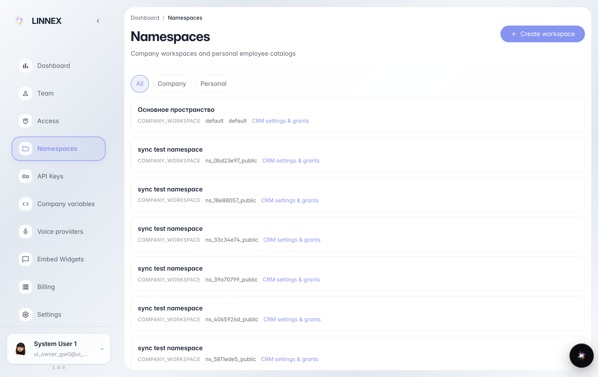
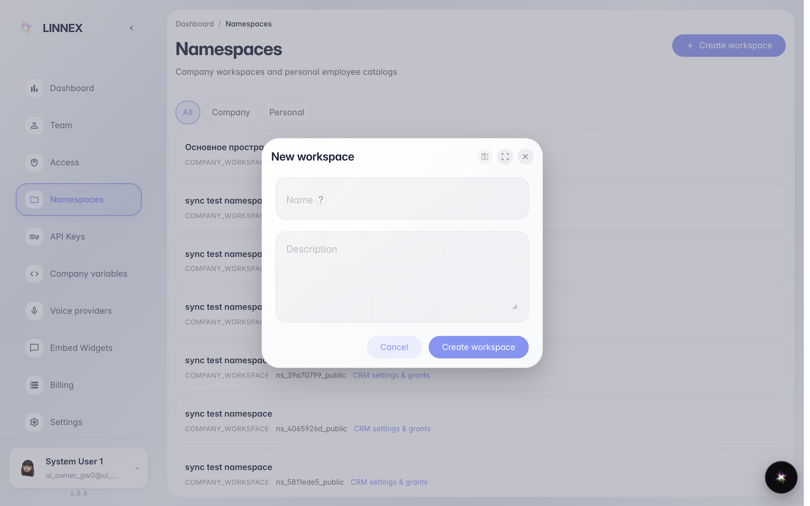
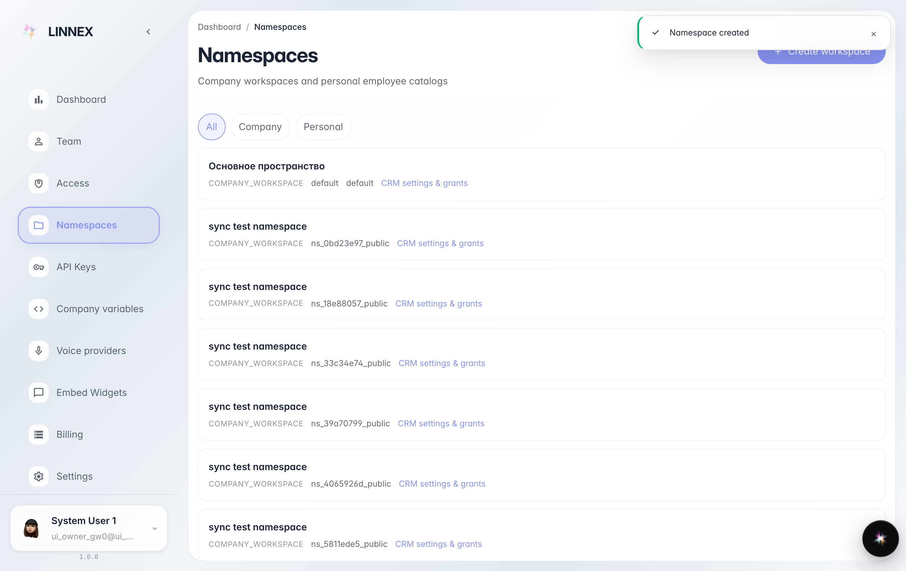

# Как посмотреть и создать пространство компании

**Для чего:** эта инструкция поможет администратору открыть список пространств компании в консоли и создать новое рабочее пространство.

**Какие проблемы решает:** вы узнаете, где в консоли лежат пространства сотрудников и отделов, как отфильтровать личные каталоги и как добавить лёгкое пространство без CRM-шаблона.

**Результат:** новое пространство видно в списке с именем, которое вы задали.

## Шаг 1. Откройте страницу пространств

В консоли платформы откройте раздел Namespaces (Пространства) в боковом меню или перейдите по адресу /namespaces. Это нужно, чтобы увидеть реестр рабочих и личных пространств компании. На экране появится заголовок страницы и список карточек.

## Шаг 2. Отфильтруйте личные пространства

Нажмите фильтр Personal (Личные). Так вы оставите в списке только именные каталоги сотрудников. Кнопка фильтра подсветится как активная.

## Шаг 3. Вернитесь к полному списку

Нажмите фильтр All (Все), чтобы снова увидеть и рабочие пространства компании, и личные каталоги. Это нужно перед созданием нового workspace — иначе карточка нового пространства не появится в текущем отфильтрованном списке.

## Шаг 4. Откройте форму создания пространства

Нажмите кнопку Create workspace (Создать пространство). Откроется окно с полями имени и описания — без выбора CRM-шаблона.

## Шаг 5. Проверьте созданное пространство в списке

**Демонстрация результата.** В списке появилась карточка с именем uiws_b8d28ff0. Рядом видна ссылка на настройки CRM — значит пространство зарегистрировано как рабочее пространство компании.

**Итог.** Теперь вы умеете открыть реестр пространств, отфильтровать личные каталоги и создать лёгкое workspace без CRM-шаблона.

