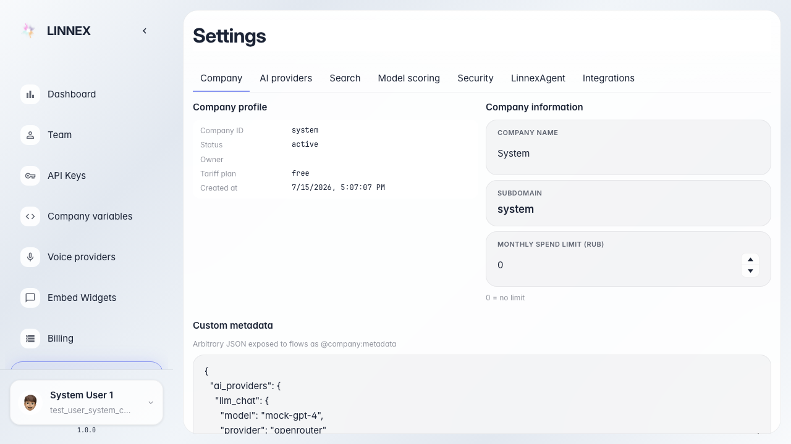
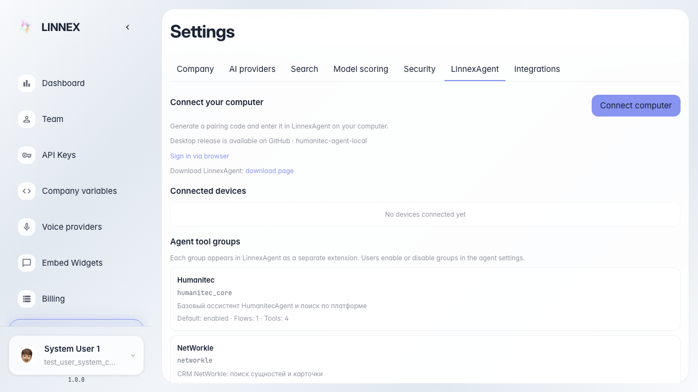

# Frontend: LinnexAgent connect section

The LinnexAgent tab shows the connect section title and button.

## Step 1. Platform settings page opened

## Step 2. LinnexAgent settings tab opened

## Step 3. LinnexAgent connect section is visible

