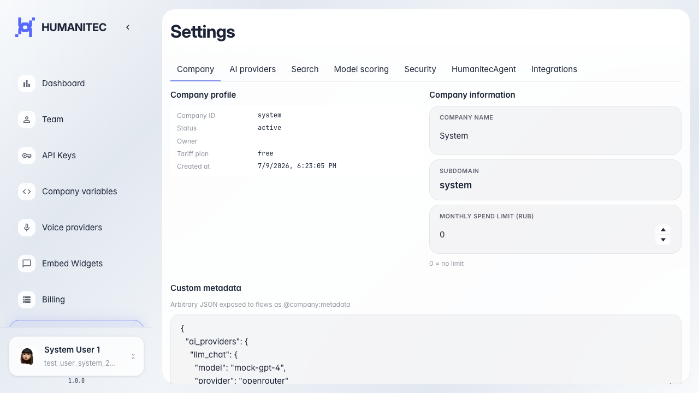

# Frontend: секция подключения LinnexAgent

На вкладке LinnexAgent отображаются заголовок и кнопка подключения.

## Шаг 1. Открыта страница настроек платформы

## Шаг 2. Открыта вкладка HumanitecAgent

## Шаг 3. Секция подключения HumanitecAgent отображается

