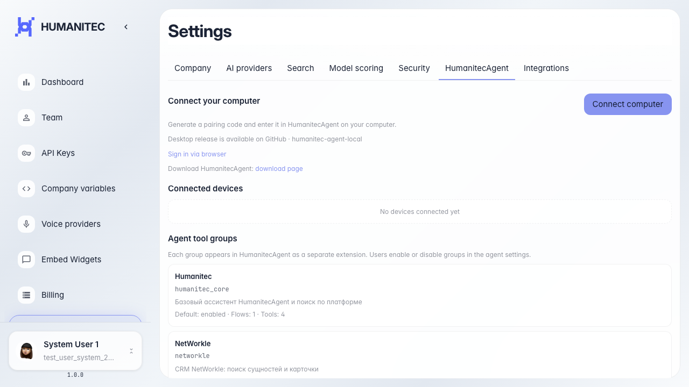

# Frontend: подсказка pairing LinnexAgent

На вкладке LinnexAgent отображается help-текст про pairing code.

## Шаг 1. Открыта страница настроек платформы

## Шаг 2. Открыта вкладка HumanitecAgent

## Шаг 3. Help-текст про pairing отображается

