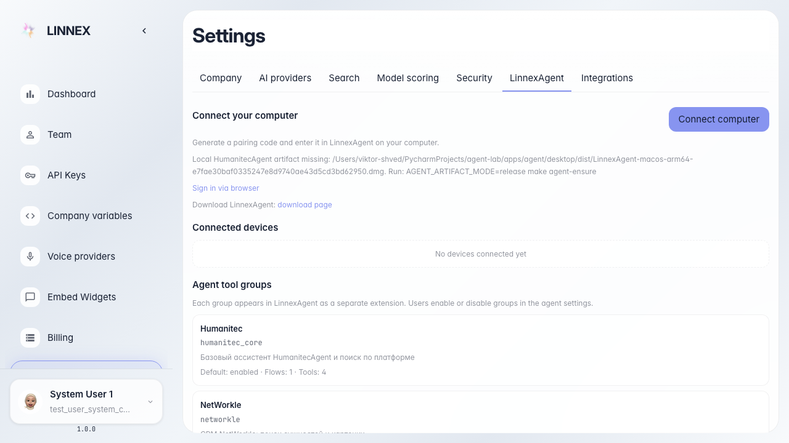
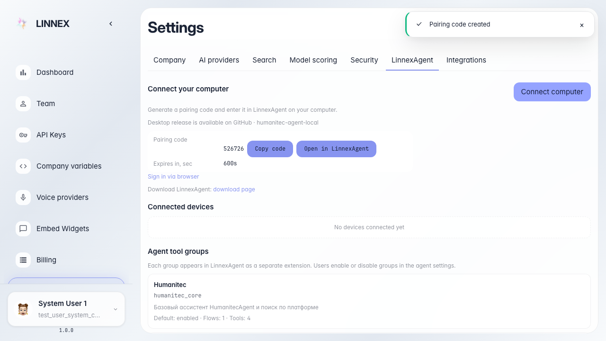

# Frontend: create LinnexAgent pairing code

The connect button creates a pairing code on the LinnexAgent tab.

## Step 1. Platform settings page opened

## Step 2. HumanitecAgent settings tab opened

## Step 3. Pairing code is created and visible

