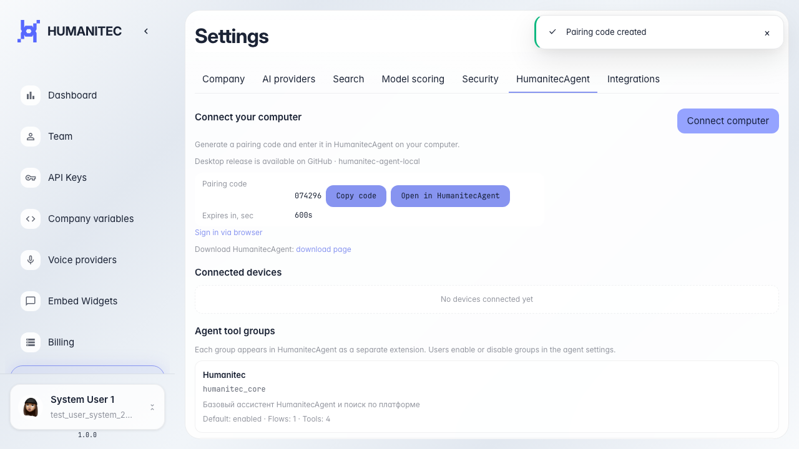

# Frontend: создание pairing code LinnexAgent

Кнопка подключения создаёт pairing code на вкладке LinnexAgent.

## Шаг 1. Открыта страница настроек платформы

## Шаг 2. Открыта вкладка HumanitecAgent

## Шаг 3. Pairing code создан и отображается

