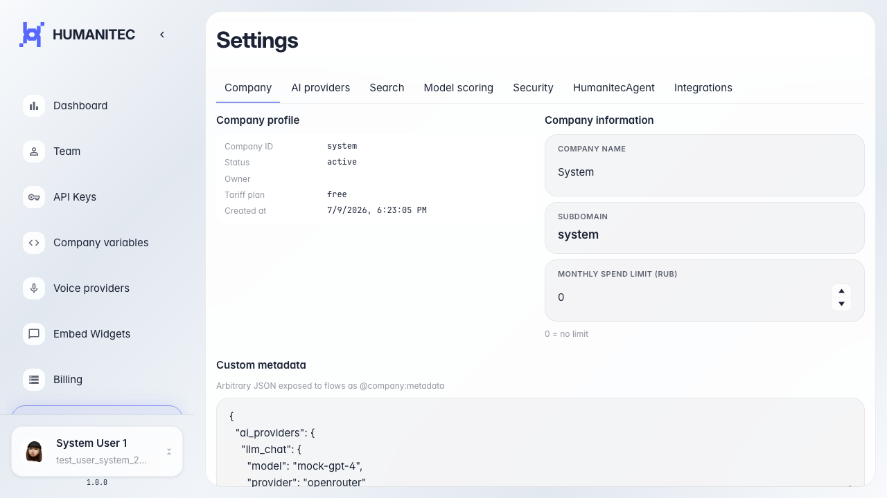
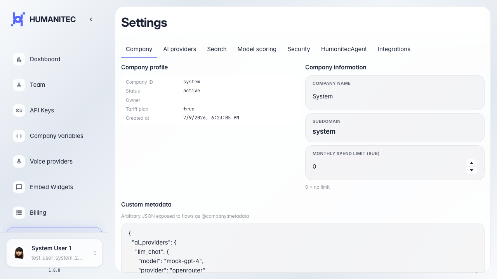

# Frontend: вкладка LinnexAgent в настройках

Страница настроек открывается, вкладка LinnexAgent доступна.

## Шаг 1. Открыта страница настроек платформы

## Шаг 2. Вкладка HumanitecAgent видна на странице настроек

