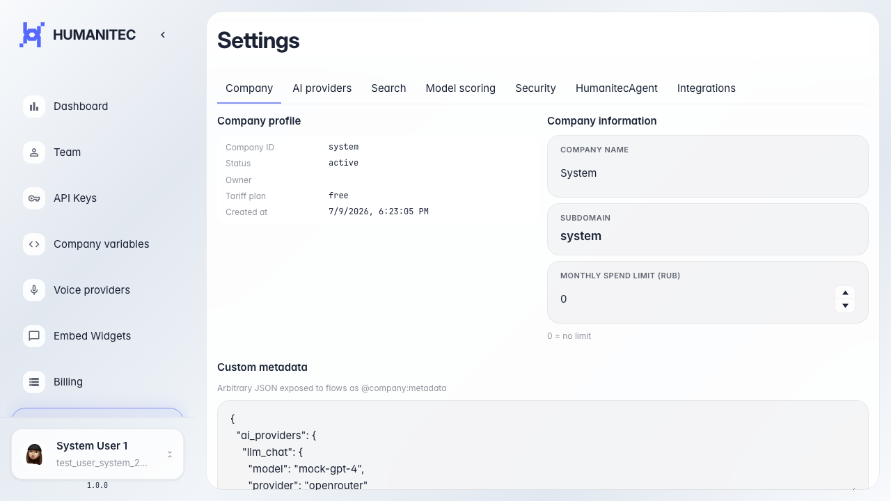
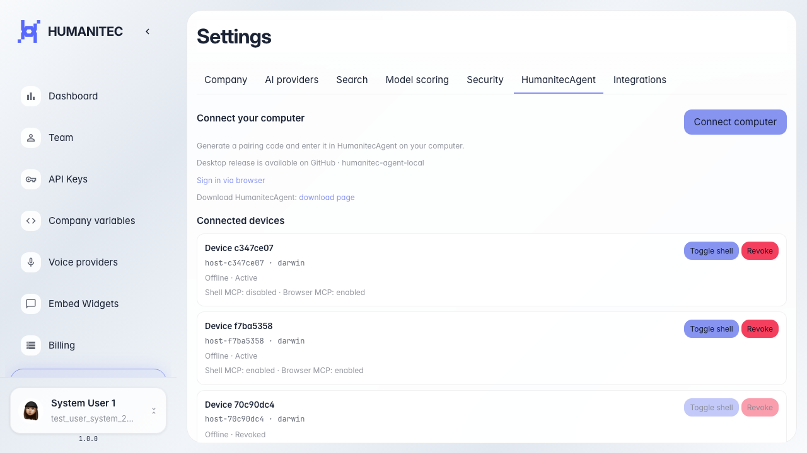

# Frontend: LinnexAgent toolkits section

LinnexAgent tab shows platform toolkit groups list.

## Step 1. Platform settings page opened

## Step 2. Agent toolkits section is visible

## Step 3. Toolkit groups list is rendered

