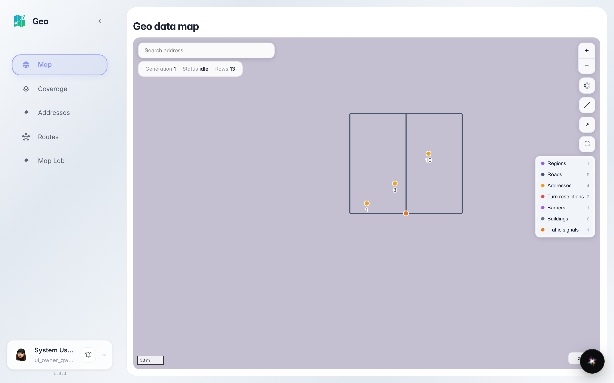
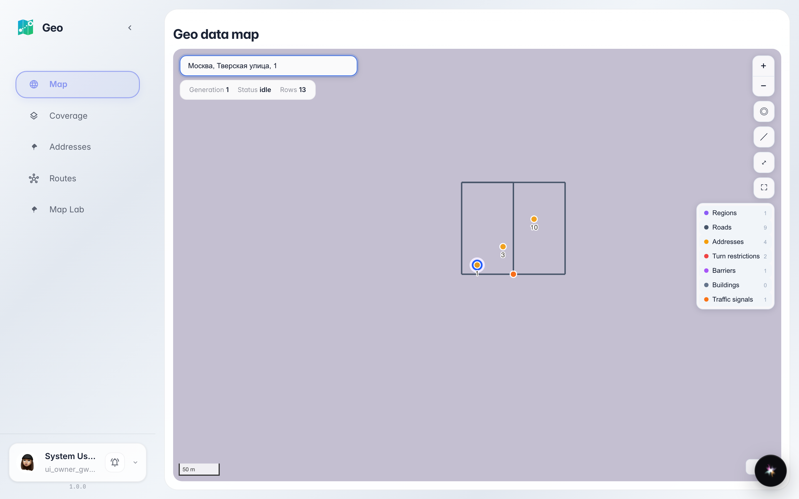

# Find an address on the map

The map search box in Geo suggests addresses from the directory: pick a suggestion — the map flies to the point and drops a pin.

## Step 1. Open Geo — the map is right there

Geo opens with a map of your city. On the left — section menu, on top of the map — an address search box. The address directory is already connected — you can search right away.

## Step 2. Type an address and pick a suggestion

**Result demonstration.** Start typing the address — the first letters of the street are enough. Suggestions from the directory appear under the box: pick one — the map flies to the point and drops a pin.

**Summary.** The address is found in seconds: no manual map scrolling — search knows the directory and takes you straight to the building.

