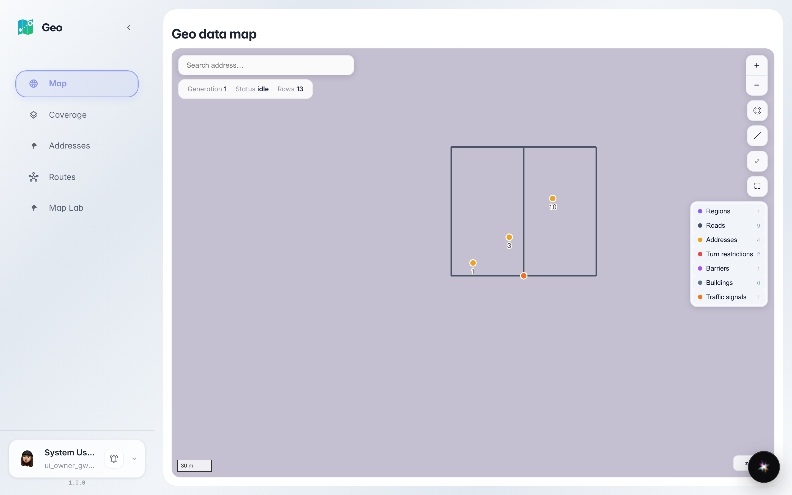
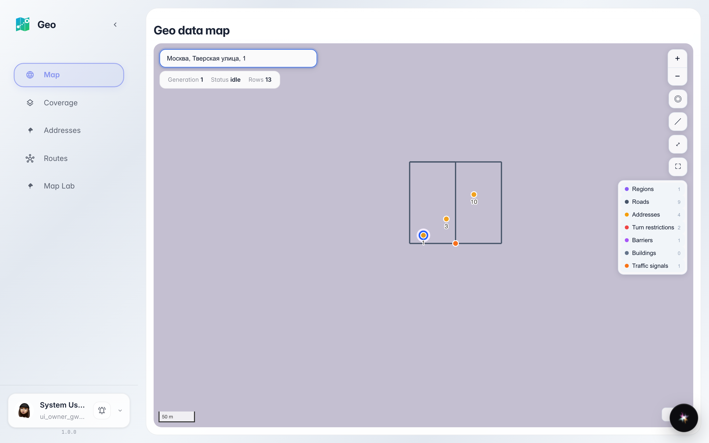

# Находим адрес на карте

Строка поиска на карте Geo подсказывает адреса из справочника: выбираем подсказку — карта сама переносится к точке и ставит пин.

## Шаг 1. Откройте Geo — сразу видна карта

Geo открывается картой вашего города. Слева — меню разделов, сверху на карте — строка поиска адреса. Справочник адресов уже подключён — искать можно сразу.

## Шаг 2. Наберите адрес и выберите подсказку

**Демонстрация результата.** Начните печатать название улицы — например, «Тверская». Под строкой появятся подсказки из справочника: выберите нужную — карта сама перелетит к точке и поставит пин.

**Итог.** Адрес найден за секунды: не нужно листать карту вручную — поиск знает справочник и приводит вас прямо к дому.

