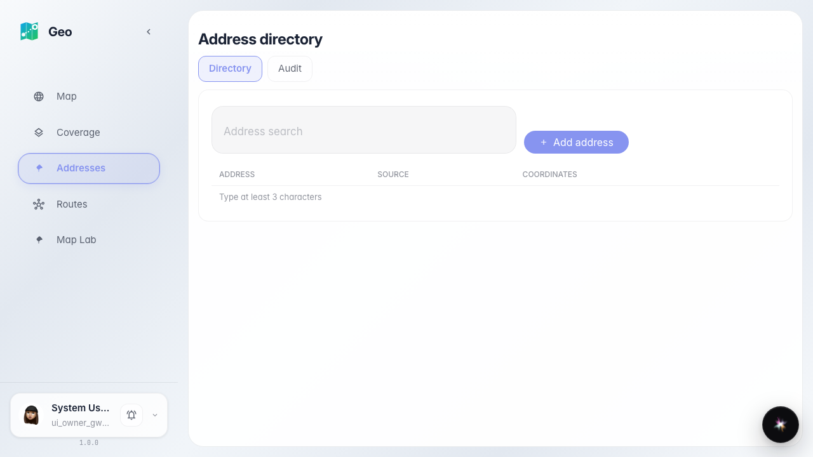
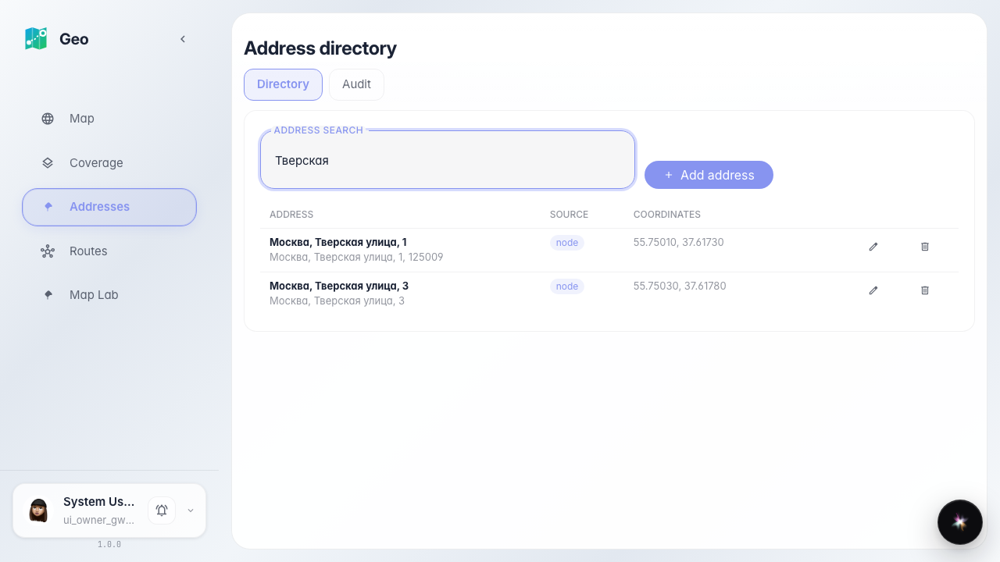
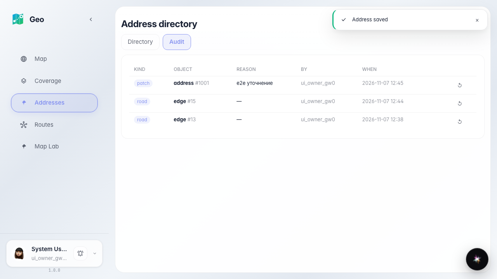
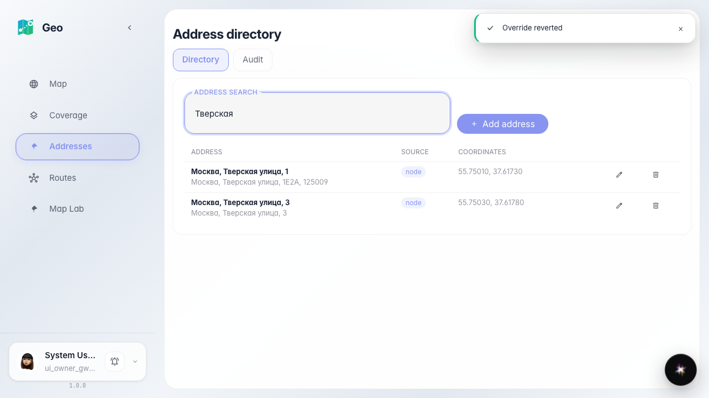

# Geo: admin edits an address

The administrator searches for an address, edits the house number in the editor modal, sees the patch in the audit tab and reverts it.

## Step 1. Addresses page opened: search, tabs, empty table

## Step 2. Search 'Tverskaya': addresses of the active generation found

## Step 3. Editor modal: address fields and mini-map with marker

## Step 4. Audit tab: patch recorded with reason and actor

## Step 5. Revert: address restored to the source value

