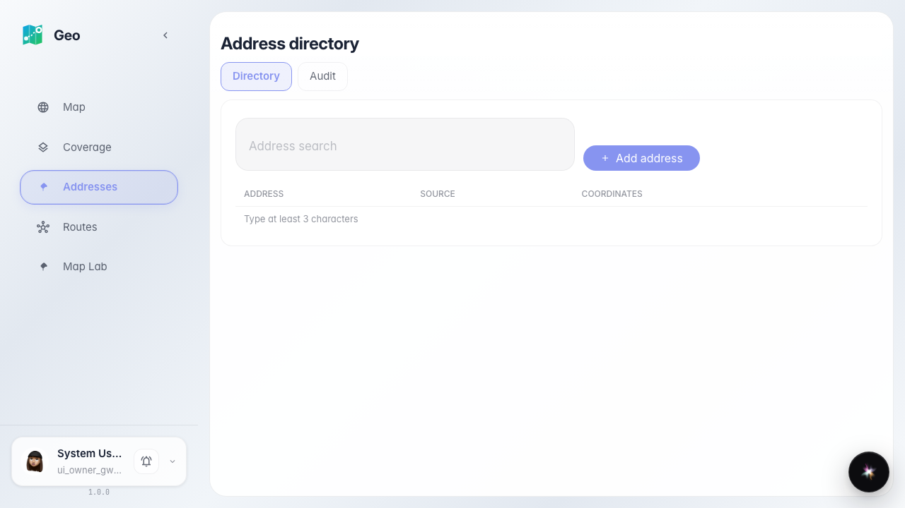
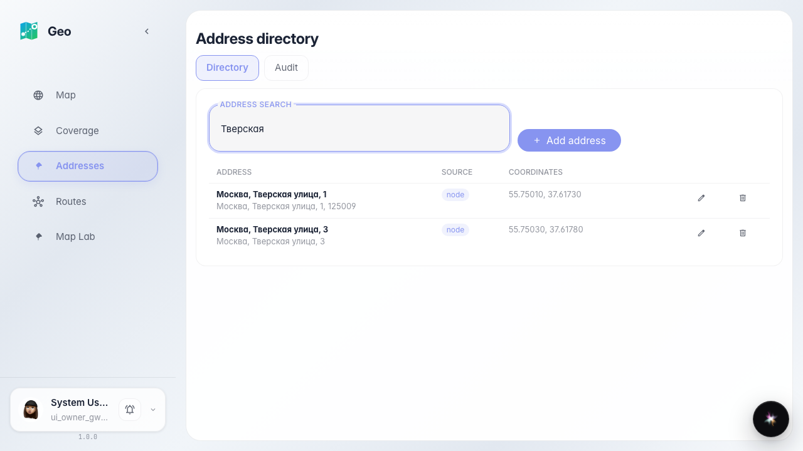
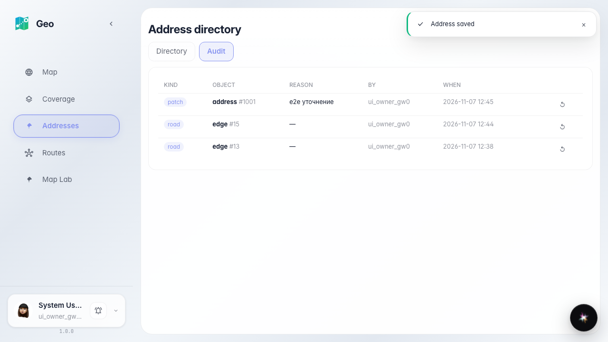
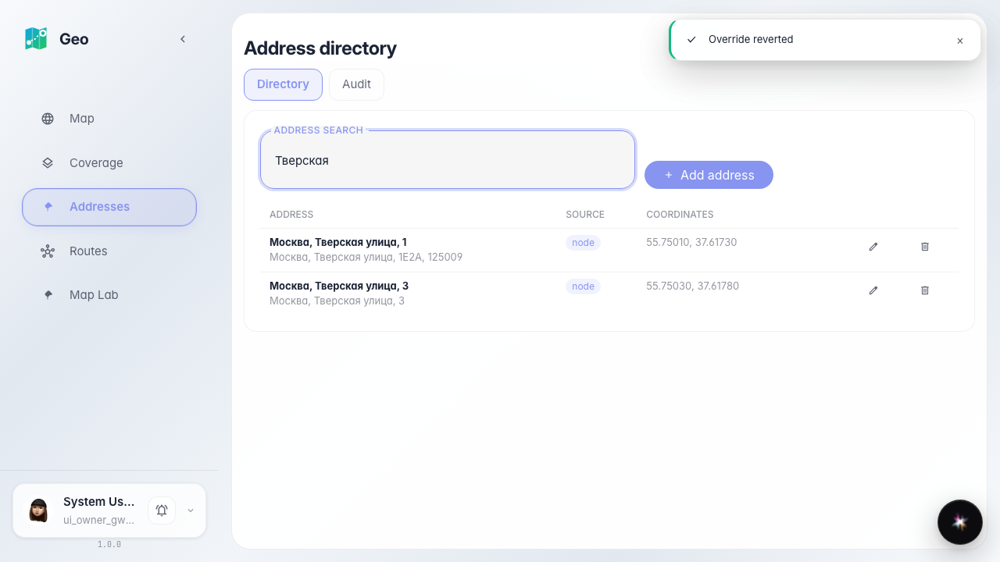

# Geo: правка адреса администратором

Администратор находит адрес поиском, правит номер дома в модалке редактора, видит правку в аудите и откатывает её.

## Шаг 1. Страница «Адреса» открыта: поиск, вкладки, пустая таблица

## Шаг 2. Поиск «Тверская»: найдены адреса активного поколения

## Шаг 3. Модалка редактора: поля адреса и мини-карта с маркером

## Шаг 4. Вкладка «Аудит правок»: патч записан с причиной и автором

## Шаг 5. Откат правки: адрес вернулся к исходному значению

