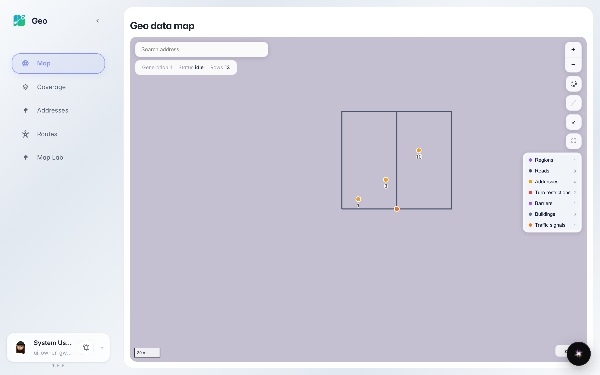
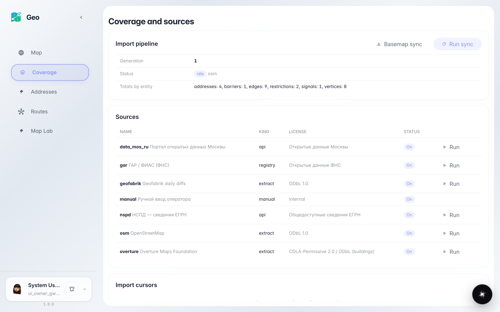
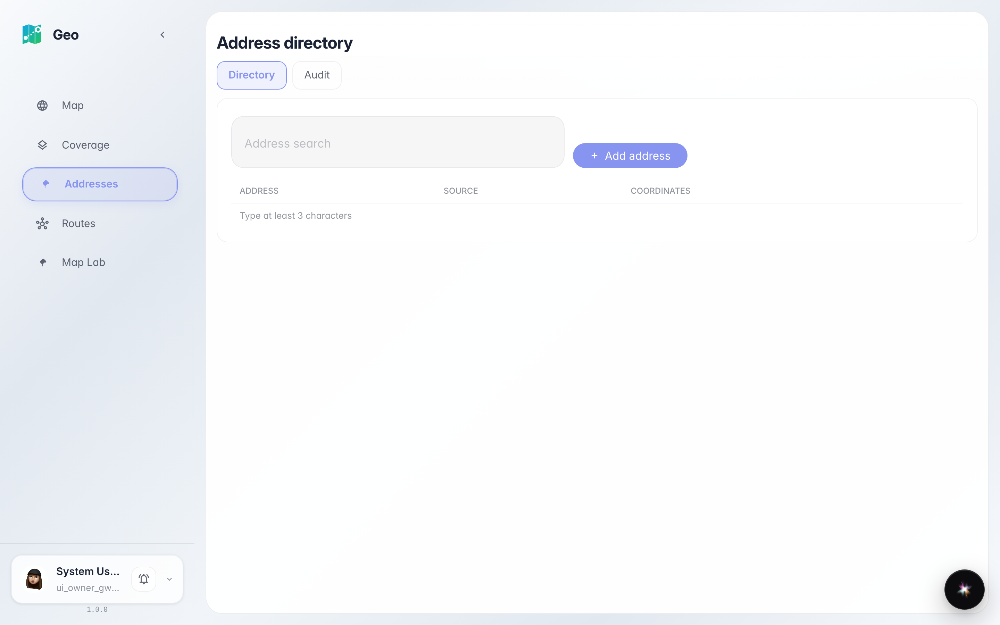
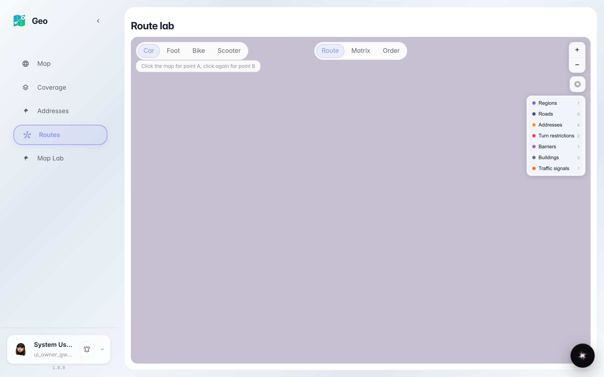
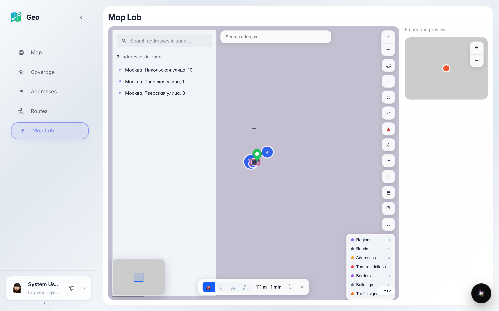

# Meet Geo: map, addresses, sources, labs

A tour of the Geo sections: city map, address directory, geodata sources and the route/map labs.

## Step 1. Home — the live city map

Geo opens with a map: dots are houses from the address directory, lines are roads for routing. On top — the address search, on the right — map tools and the layer legend.

## Step 2. «Coverage» — where the data comes from

The «Coverage» section shows geodata sources: what was imported, when it updated and how many objects the system knows. Usually nothing to do here — an info screen for checking data freshness.

## Step 3. «Addresses» — the company directory

«Addresses» holds the directory: every house and point the system uses for search and routing. The table search finds an address by street name.

## Step 4. «Routes» — the route lab

«Routes» is where routes are built on the map: two clicks set points A and B, and the system shows distance and duration. See the route lab guide for details.

## Step 5. «Map Lab» — the widget showcase

**Summary.** «Map Lab» shows the map widget: markers, clusters and search in miniature. You now know every Geo section: map on home, address directory, source coverage and two labs for routes and the map.

