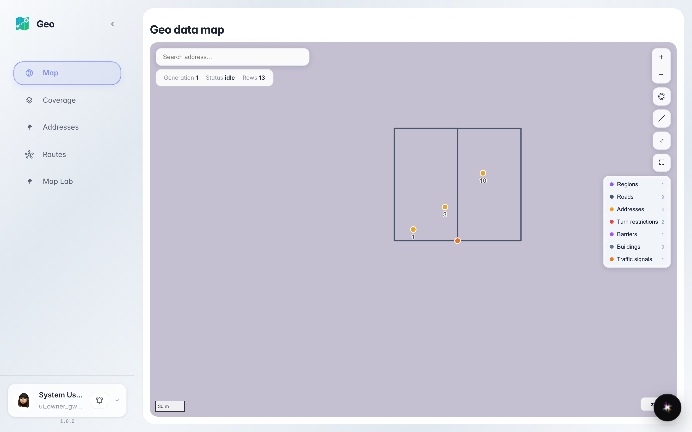
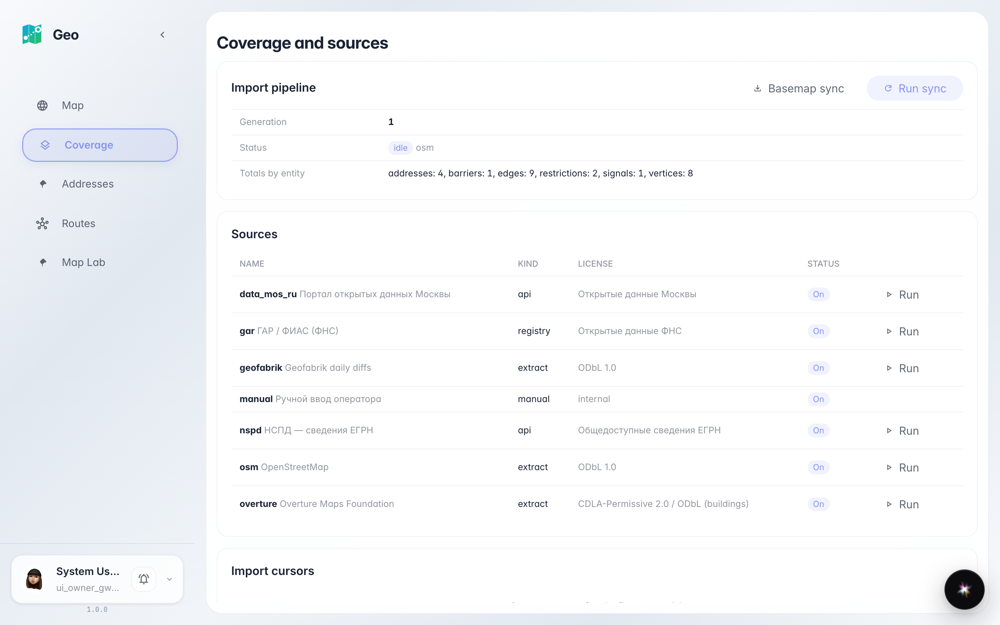
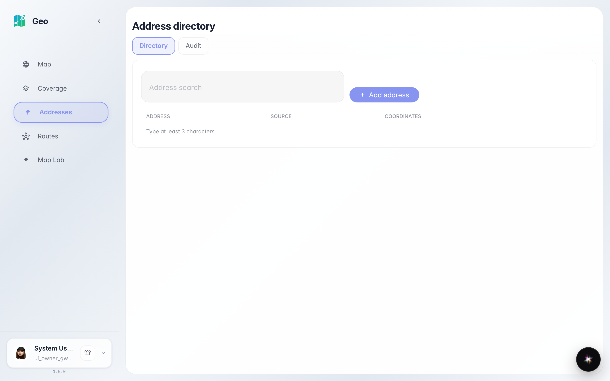
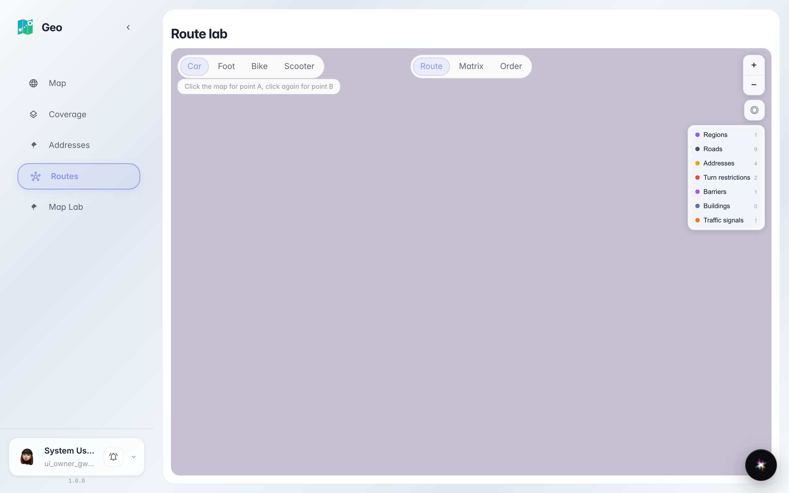
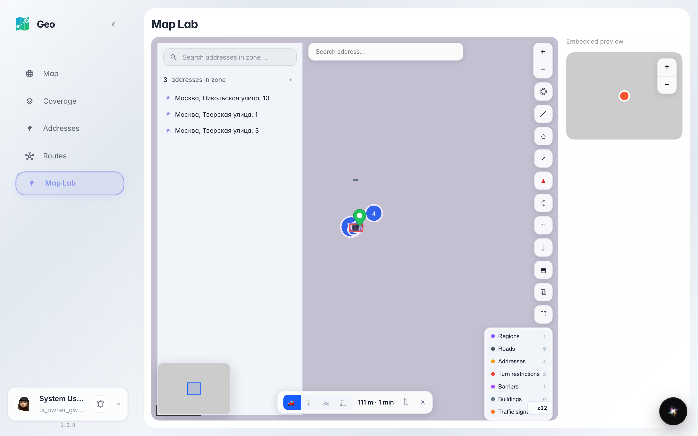

# Знакомимся с Geo: карта, адреса, источники, лаборатории

Обзорный тур по разделам Geo: карта города, справочник адресов, источники геоданных и лаборатории маршрутов и карты.

## Шаг 1. Главная — живая карта города

Geo открывается картой: точки — дома из справочника адресов, линии — дороги для маршрутов. Сверху строка поиска адреса, справа — инструменты карты и легенда слоёв.

## Шаг 2. «Покрытие» — откуда данные

Раздел «Покрытие» показывает источники геоданных: что импортировано, когда обновлялось и сколько объектов знает система. Обычно здесь ничего делать не нужно — это информационный экран для проверки свежести данных.

## Шаг 3. «Адреса» — справочник компании

В «Адресах» живёт справочник: все дома и точки, которые система использует для поиска и маршрутов. Поиск по таблице находит адрес по названию улицы.

## Шаг 4. «Маршруты» — лаборатория маршрутов

«Маршруты» — место, где строят маршруты на карте: два клика ставят точки A и B, а система показывает дистанцию и время. Подробнее — в инструкции про маршрутную лабораторию.

## Шаг 5. «Лаборатория карты» — витрина виджета

**Итог.** «Лаборатория карты» — демонстрация виджета карты: маркеры, кластеры и поиск в миниатюре. Теперь вы знаете все разделы Geo: карта на главной, справочник адресов, покрытие источников и две лаборатории для маршрутов и карты.

