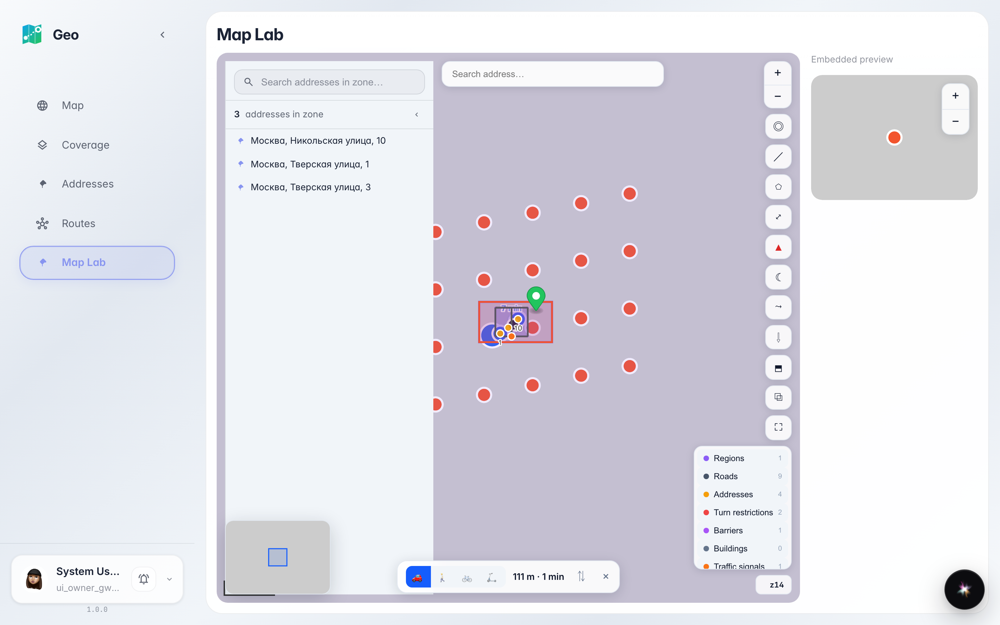
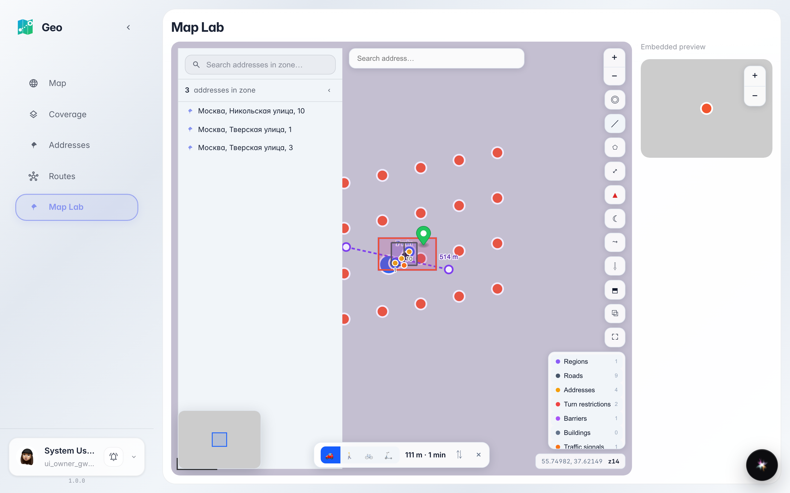
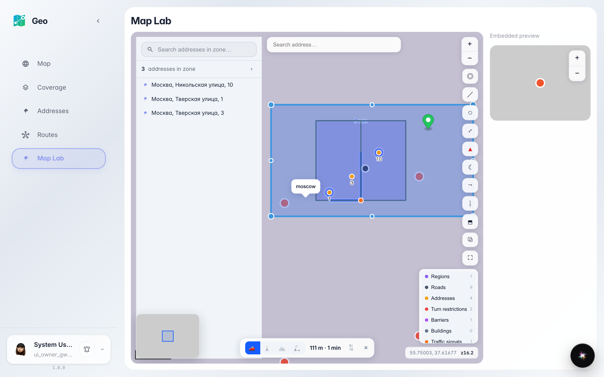

# Geo map: markers, zones and ruler

The «Map» section shows every platform-map capability on a live example: point clusters, a highlighted zone, a route, reachability rings and a distance ruler.

## Step 1. Open «Map» in the Geo menu

The «Map» section is a showcase of the company geo capabilities. The map immediately shows: point markers (blue — courier, green — depot), a round cluster badge grouping nearby points, a purple outline — a highlighted zone, a line — a built route, and rings around a point — 3- and 7-minute walking reachability zones. The left panel lists addresses inside the highlighted zone. On the right — a compact preview map that can be embedded into other pages.

## Step 2. Measure a distance with the ruler

Click the ruler button on the map toolbar and click two points — a line with the distance in meters or kilometers appears between them. Each next click extends the polyline, and pressing the button again finishes the measurement.

## Step 3. Expand a point cluster

When many points are close together, the map groups them into a round badge with a count. Clicking it zooms in — and each point becomes visible separately. Clustering works the same way in every service that has a map.

**Summary.** The Geo map can show markers and clusters, highlighted zones, routes and reachability rings, and the ruler measures distance right on the map.

