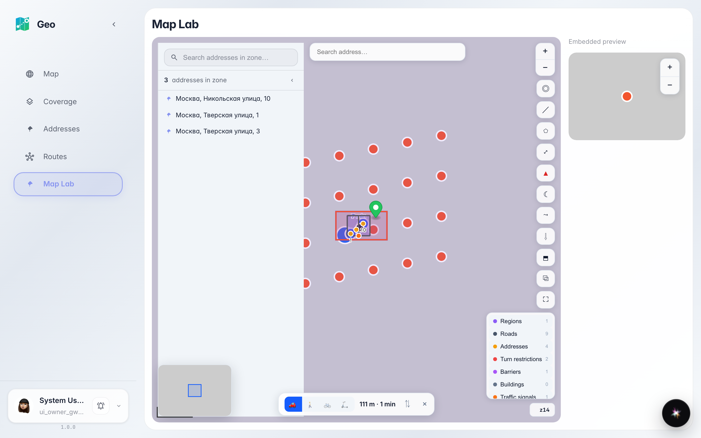
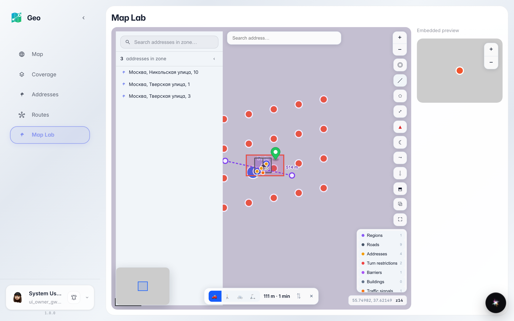
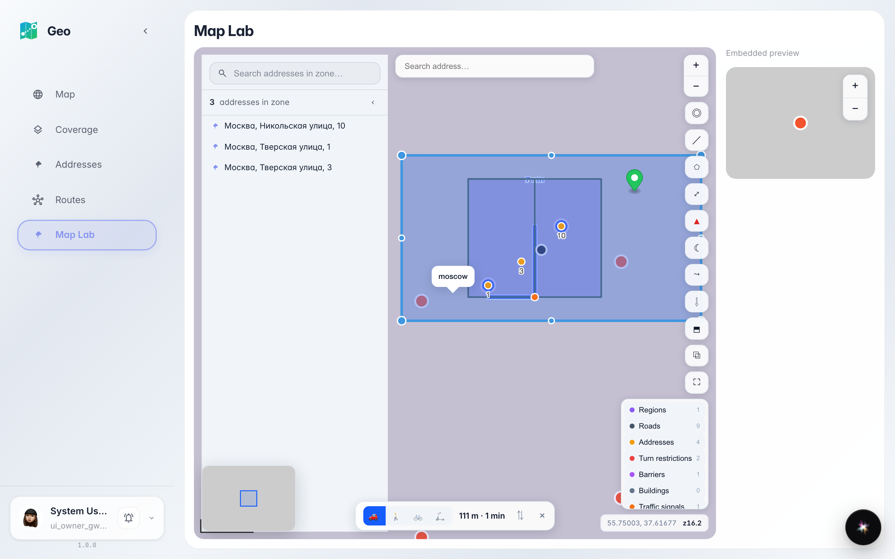

# Карта Geo: маркеры, зоны и линейка

Раздел «Карта» показывает все возможности платформенной карты на живом примере: кластеры точек, выделенная зона, маршрут, зоны доступности и линейка для измерения расстояний.

## Шаг 1. Откройте «Карту» в меню Geo

Раздел «Карта» — витрина гео-возможностей компании. На карте сразу видно: маркеры точек (синяя — курьер, зелёная — склад), круглый значок кластера объединяет близкие точки, фиолетовый контур — выделенная зона, линия — построенный маршрут, а кольца вокруг точки — зоны доступности за 3 и 7 минут пешком. Панель слева показывает адреса, попавшие в выделенную зону. Справа — пример компактной карты-превью, которую можно встраивать в другие страницы.

## Шаг 2. Измерьте расстояние линейкой

Нажмите кнопку линейки на панели инструментов карты и кликните две точки — между ними появится линия с расстоянием в метрах или километрах. Каждый следующий клик продолжает ломаную, а повторное нажатие кнопки завершает измерение.

## Шаг 3. Раскройте кластер точек

Когда точек много рядом, карта объединяет их в круглый значок с числом. Клик по нему приближает карту — и каждая точка становится видна отдельно. Так работает кластеризация во всех сервисах, где есть карта.

**Итог.** Карта Geo умеет показывать маркеры и кластеры, выделенные зоны, маршруты и зоны доступности, а линейка измеряет расстояние прямо на карте.

