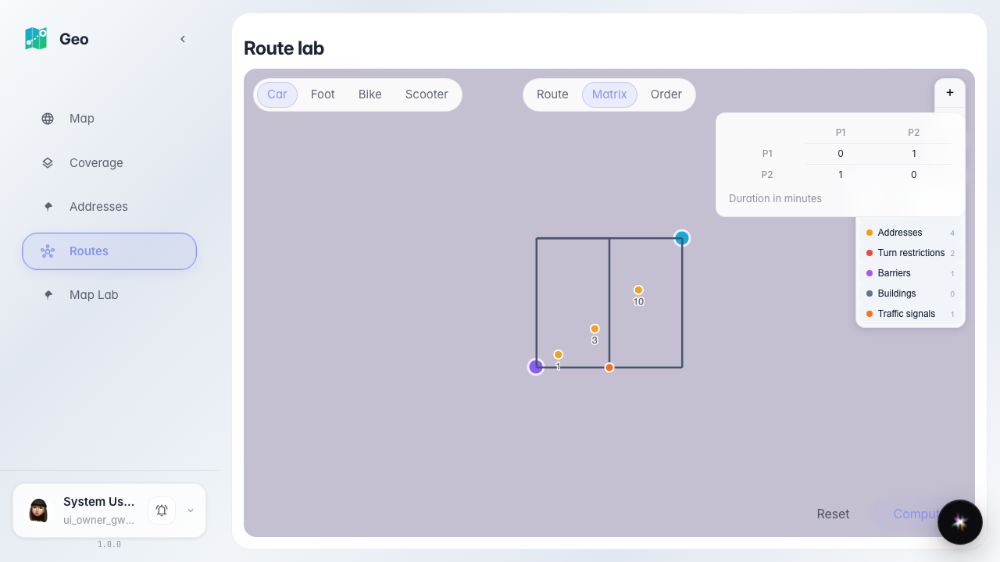
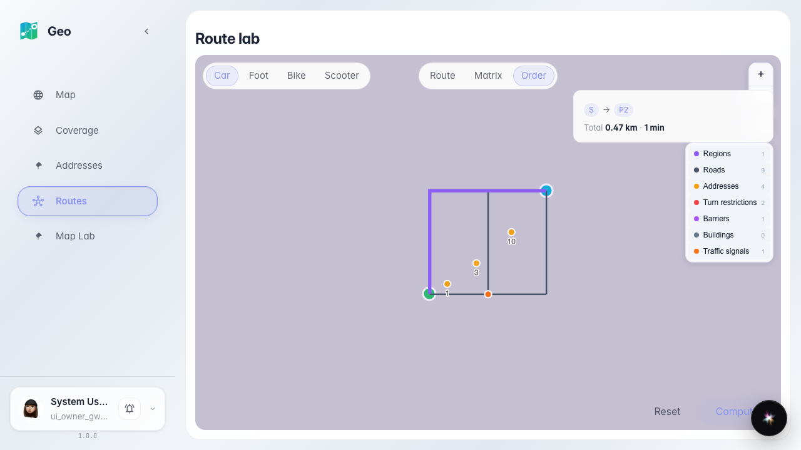

# Geo: time matrix and optimal order

Lab tools: N×N duration matrix over the road graph and optimal stop ordering for deliveries.

## Step 1. 2×2 duration matrix computed by the real engine

## Step 2. Optimal order: sequence S → P2 with route totals

