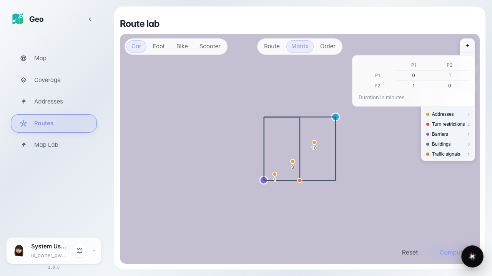
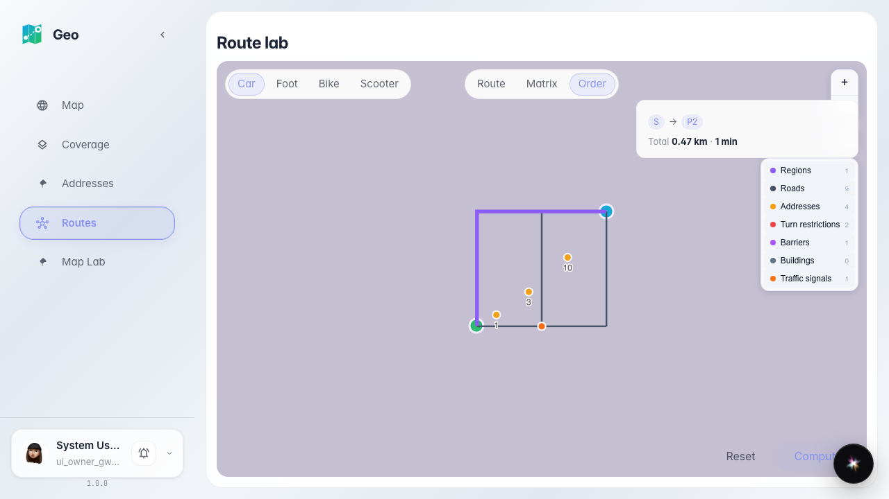

# Geo: матрица времени и оптимальный объезд

Инструменты лаборатории: матрица N×N длительностей по графу и оптимальный порядок объезда точек доставки.

## Шаг 1. Матрица 2×2 длительностей построена боевым движком

## Шаг 2. Оптимальный объезд: последовательность S → P2 и итог маршрута

