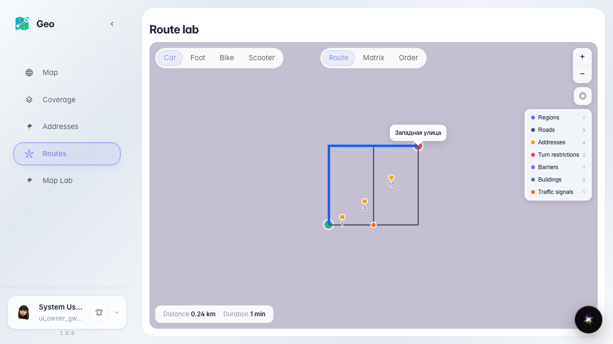
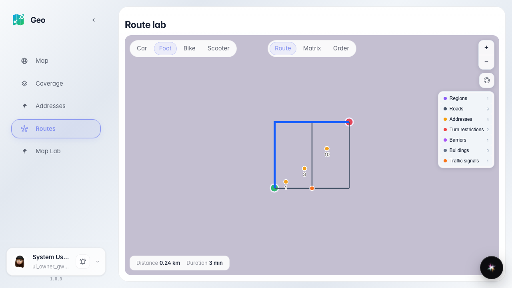

# Geo: route lab

Two map clicks build an A→B route with the real engine: distance, duration and recalculation on mode switch.

## Step 1. Route A→B built: distance and duration on the map

## Step 2. Foot mode recalculated the route

