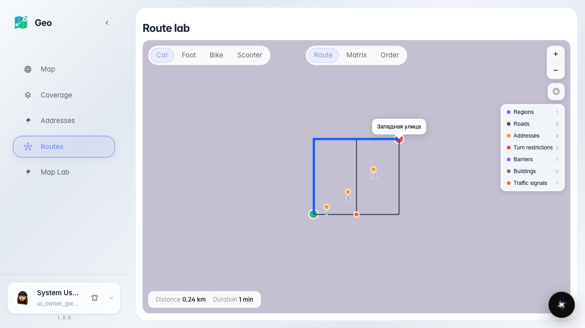
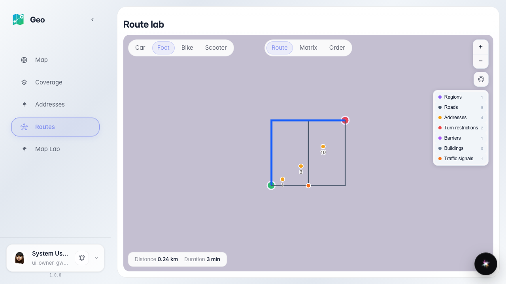

# Geo: маршрутная лаборатория

Два клика по карте строят маршрут A→B боевым движком: дистанция, время и пересчёт при смене режима движения.

## Шаг 1. Маршрут A→B построен: дистанция и время на карте

## Шаг 2. Режим «пешком» пересчитал маршрут

