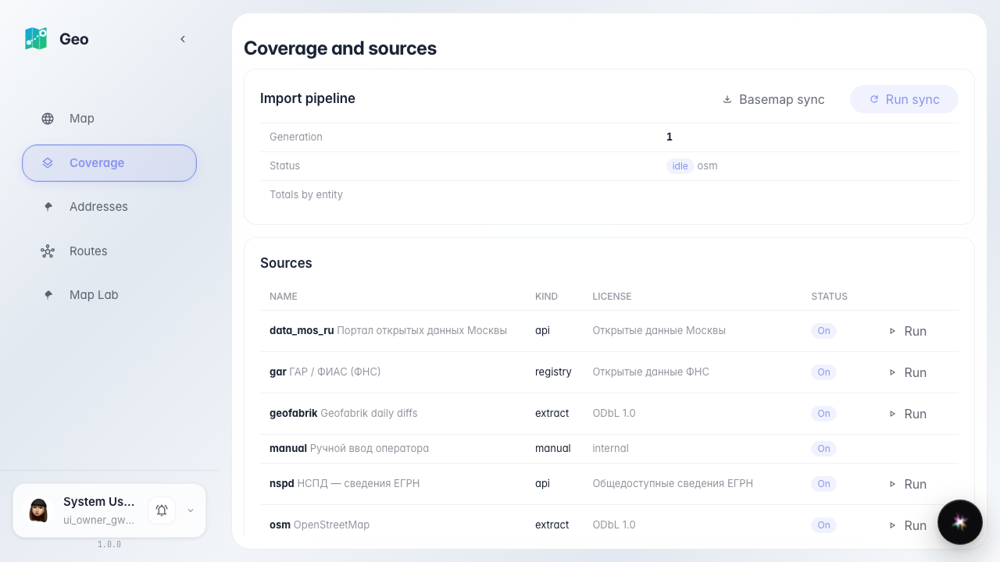
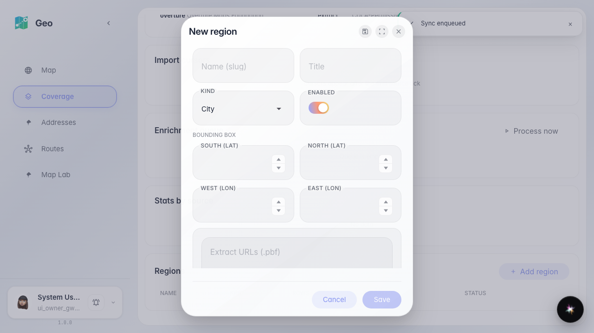
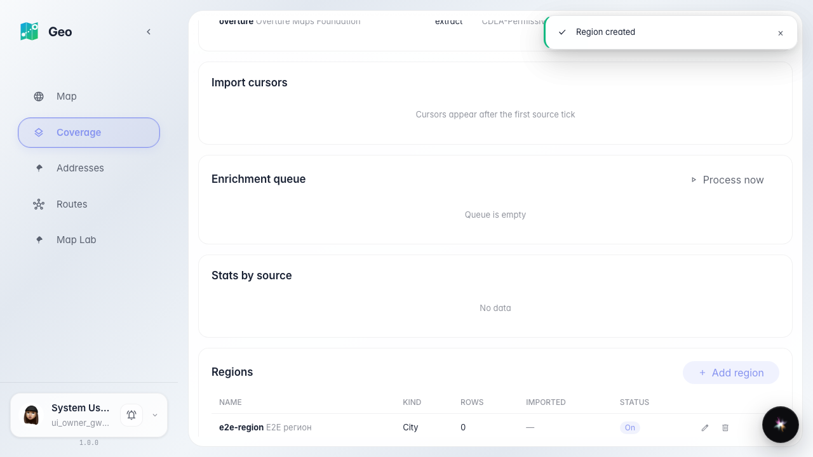
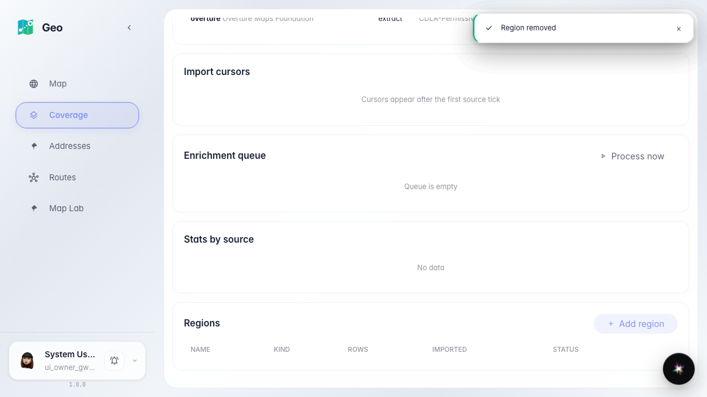

# Geo: sources and regions hub

The administrator sees pipeline status, cursors and the enrichment queue, runs a specific source and edits regions.

## Step 1. Sources hub: pipeline, sources, cursors, enrichment, stats and regions

## Step 2. Region editor: name, kind, bbox, extracts

## Step 3. Region created and listed

## Step 4. Region edited and removed — list is up to date

