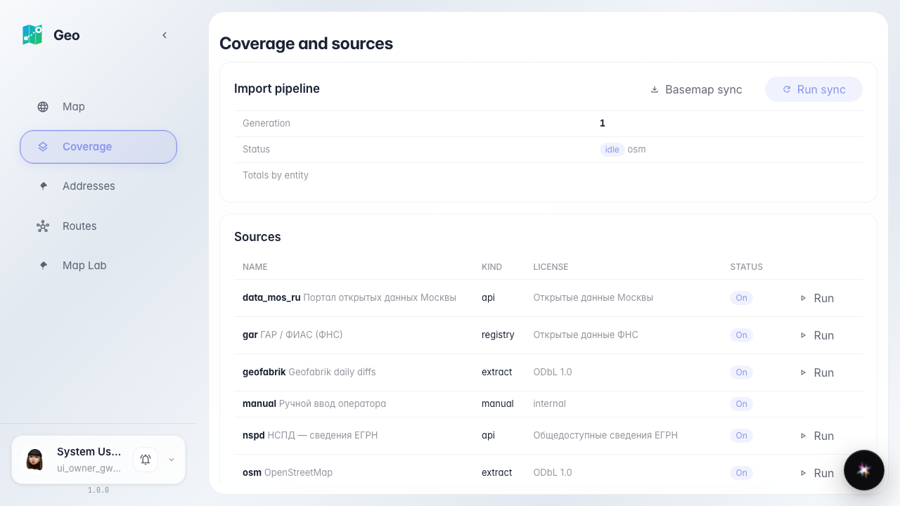
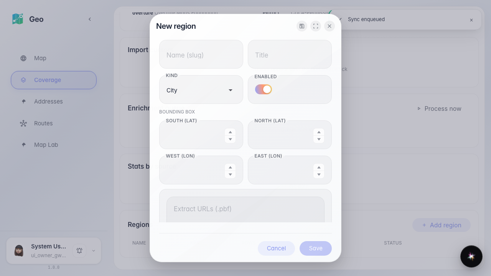
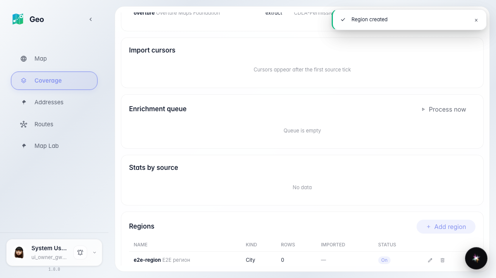
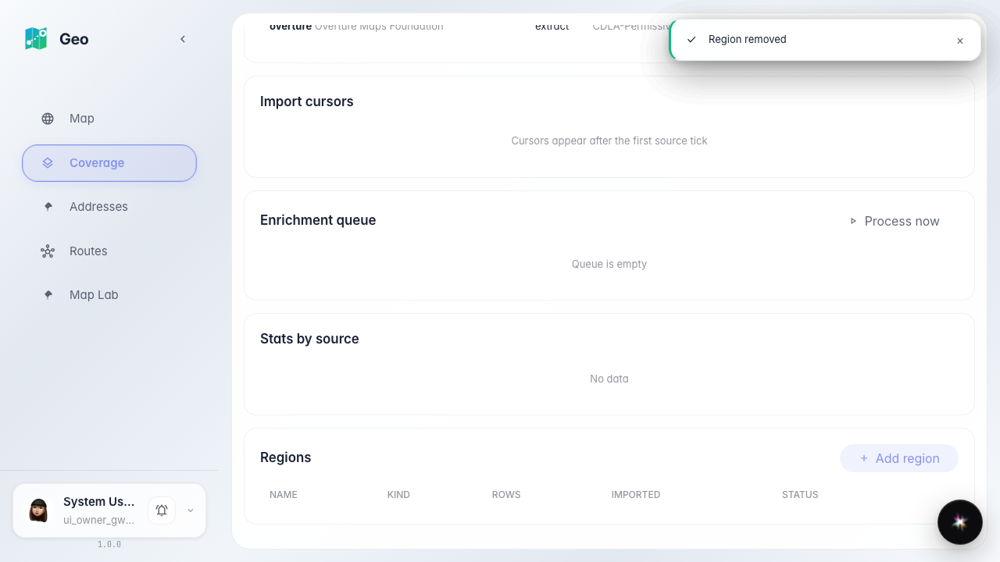

# Geo: хаб источников и регионов

Администратор видит статус конвейера, курсоры и очередь обогащения, запускает импорт источника и правит список регионов.

## Шаг 1. Хаб источников: конвейер, источники, курсоры, обогащение, статистика и регионы

## Шаг 2. Редактор региона: имя, тип, bbox, экстракты

## Шаг 3. Регион создан и виден в таблице регионов

## Шаг 4. Регион отредактирован и удалён — список актуален

