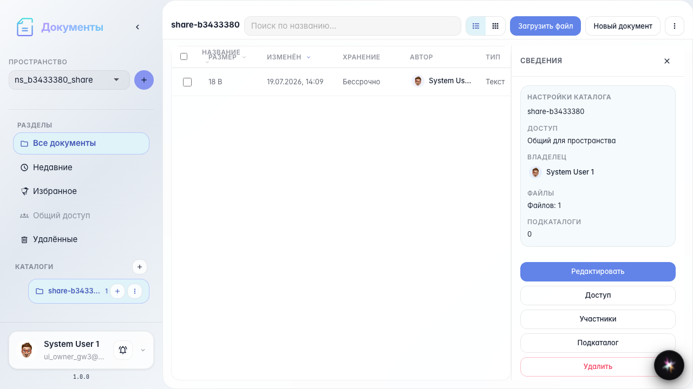
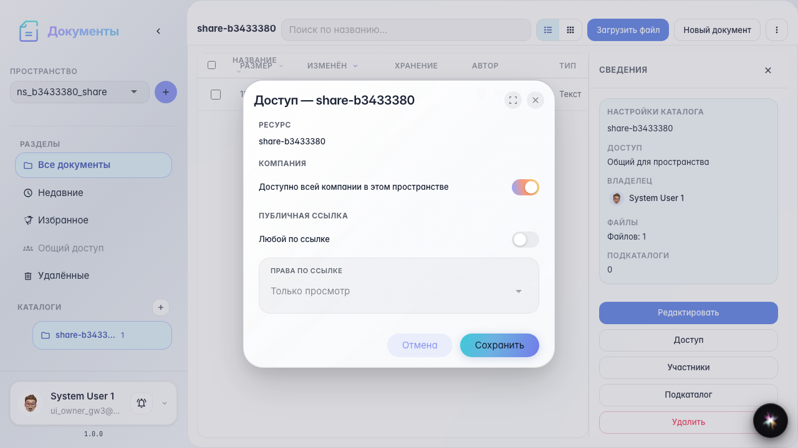
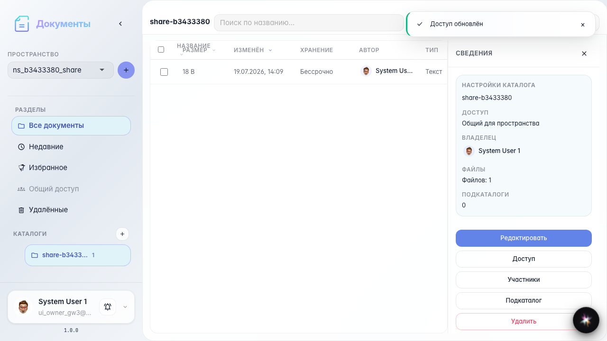
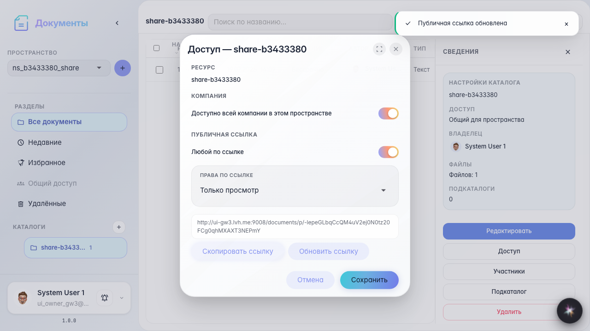
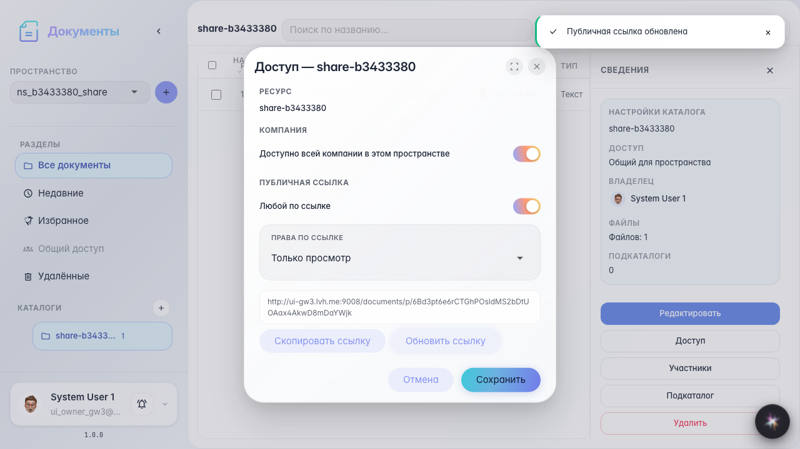
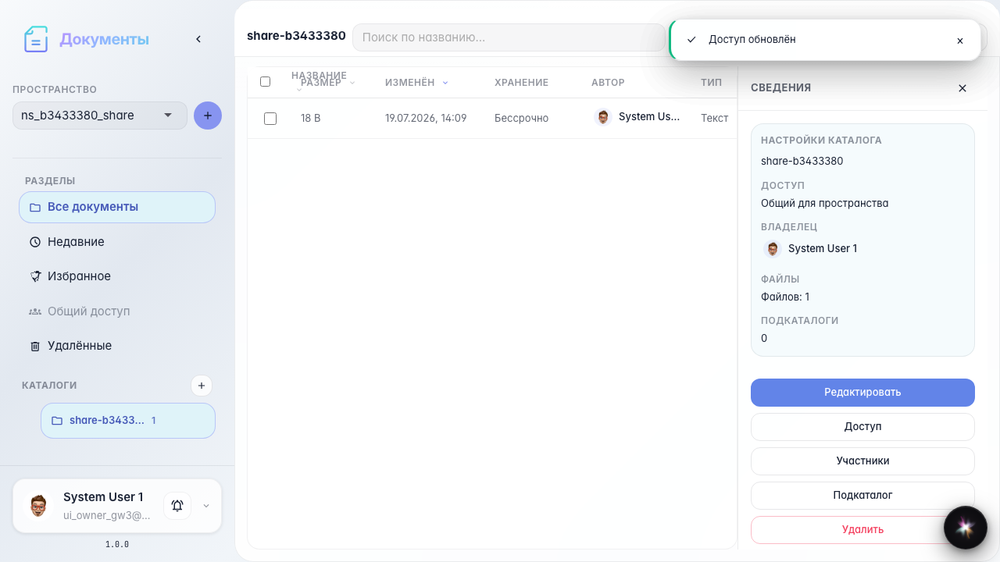
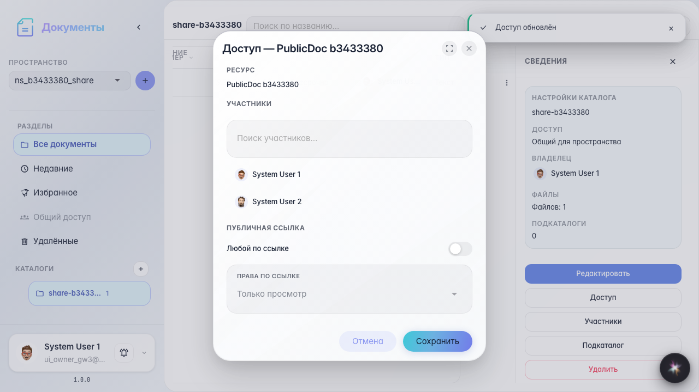

# Office: access and public link

Access modal: enable link, copy, rotate, and document-level sharing.

## Step 1. Catalog with document ready

## Step 2. Catalog access modal

## Step 3. Public link enabled

## Step 4. Link copied

## Step 5. Link rotated

## Step 6. Public link disabled

## Step 7. Document-level access

