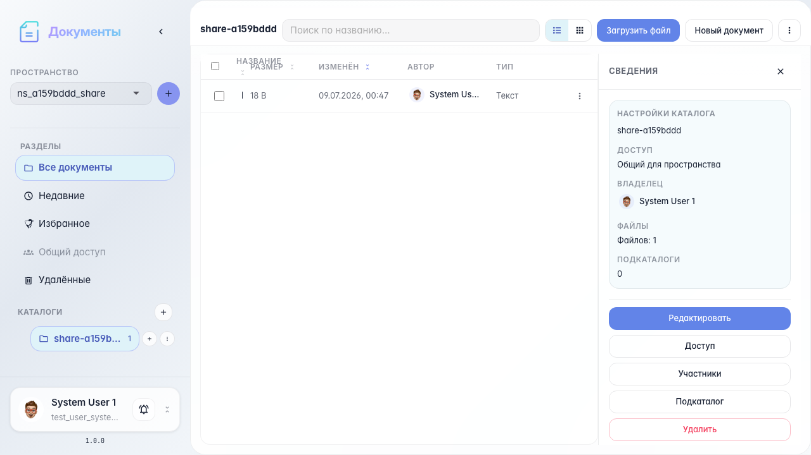
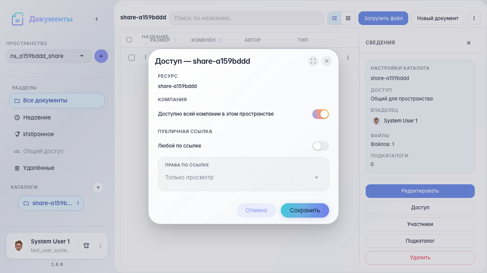
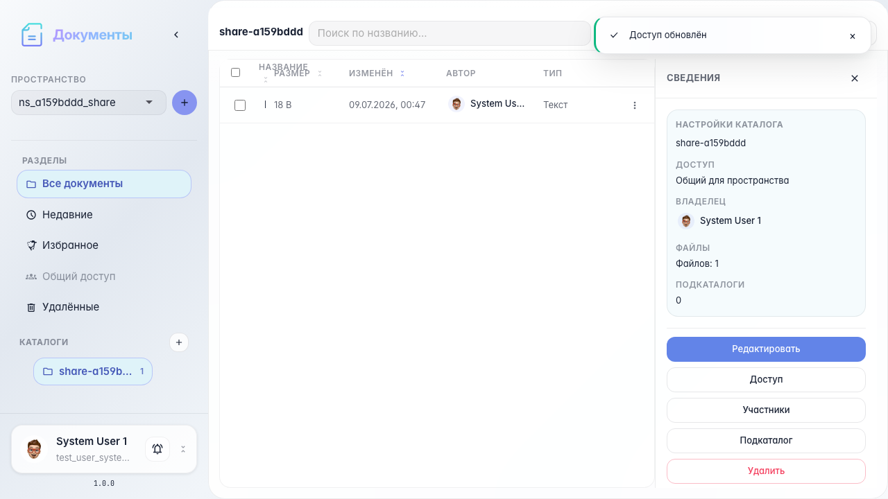

# Office: доступ и публичная ссылка

Модалка доступа: включение ссылки, копирование, ротация и доступ к документу.

## Шаг 1. Каталог с документом готов

## Шаг 2. Модалка доступа к каталогу

## Шаг 3. Публичная ссылка включена

