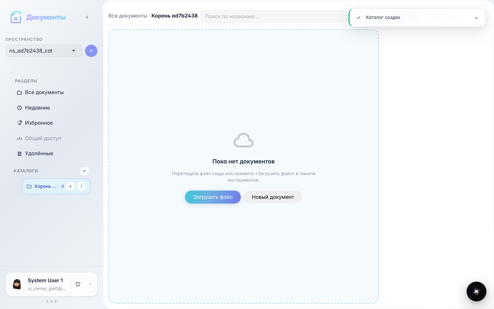
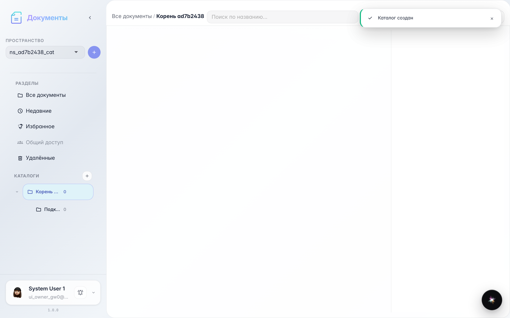
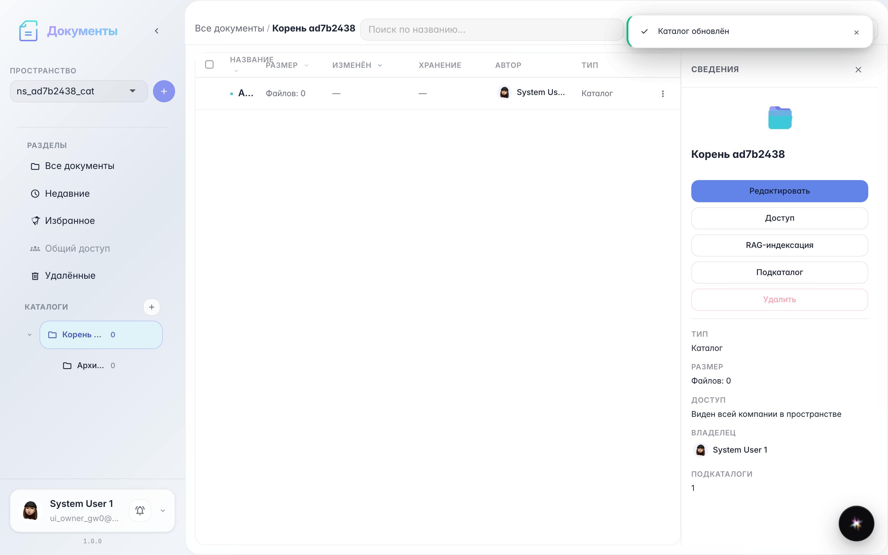

# Office: пространство и каталоги

Выбор пространства, создание корневого и вложенного каталога, редактирование и навигация по дереву.

## Шаг 1. Выбрано рабочее пространство

## Шаг 2. Создан корневой каталог

## Шаг 3. Создан вложенный каталог

## Шаг 4. Каталог переименован

## Шаг 5. Дерево каталогов и breadcrumbs

