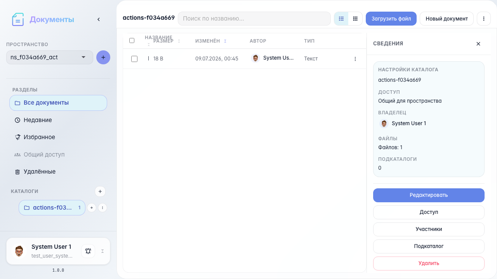
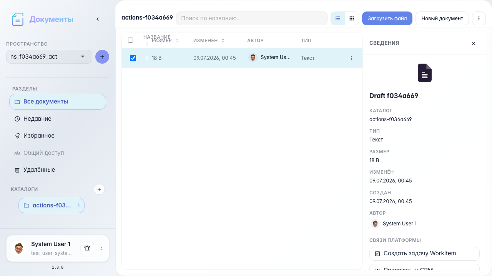
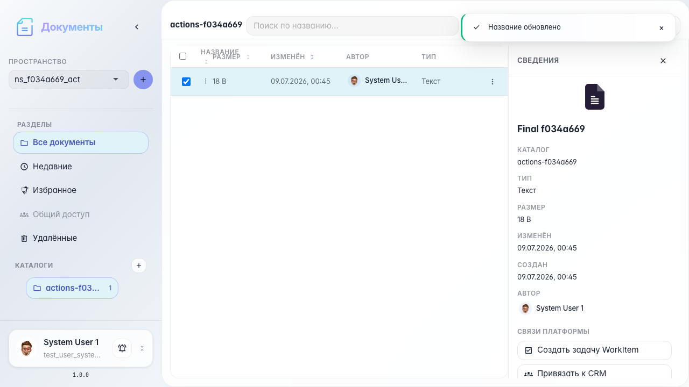
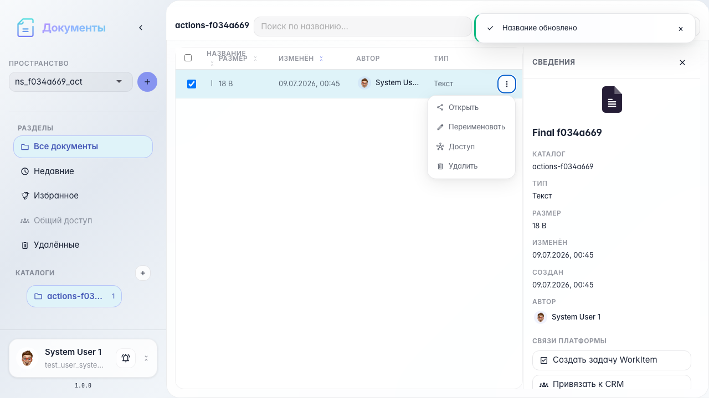
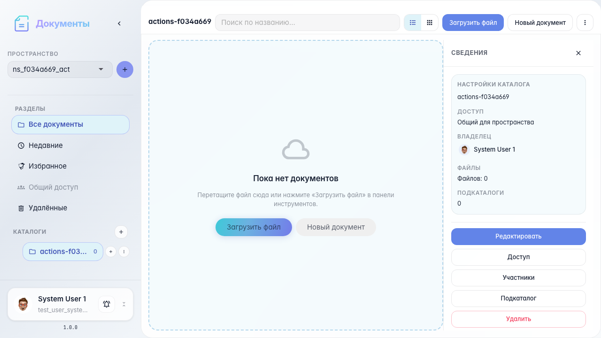

# Office: действия с документами

Открытие, переименование, контекстное меню и удаление документа.

## Шаг 1. Документ в каталоге

## Шаг 2. Документ открыт и закрыт

## Шаг 3. Документ переименован

## Шаг 4. Меню действий файла

## Шаг 5. Документ удалён

