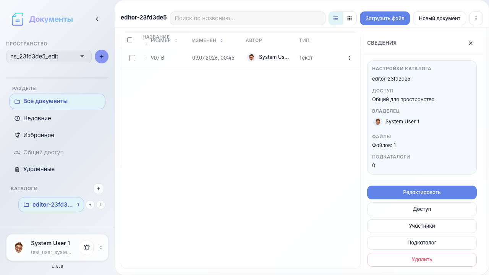
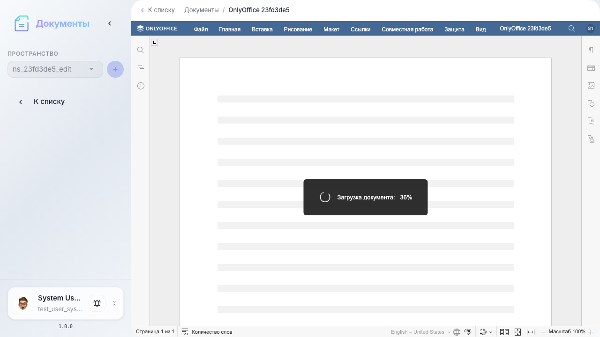
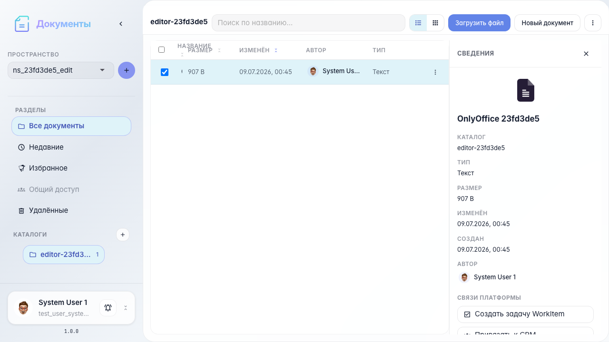
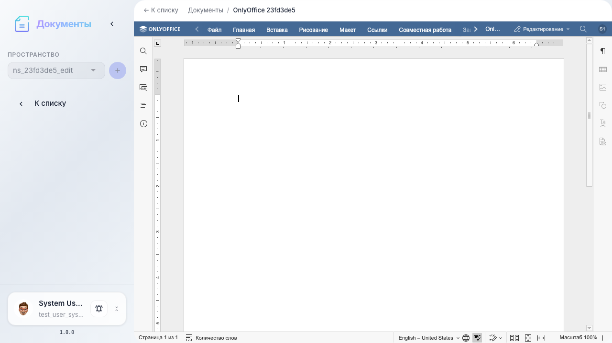

# Office: редактирование в OnlyOffice

Открытие docx в OnlyOffice, возврат в проводник и повторное открытие.

## Шаг 1. Документ Word в каталоге

## Шаг 2. OnlyOffice редактор открыт

## Шаг 3. Возврат к списку документов

## Шаг 4. Тот же документ открыт повторно

## Шаг 5. Интеграция Document Server активна

