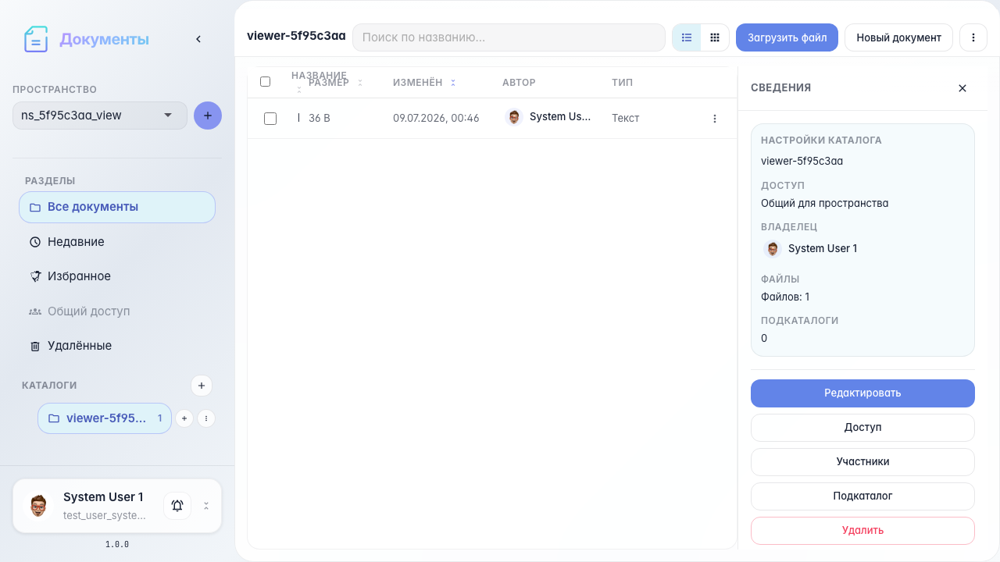
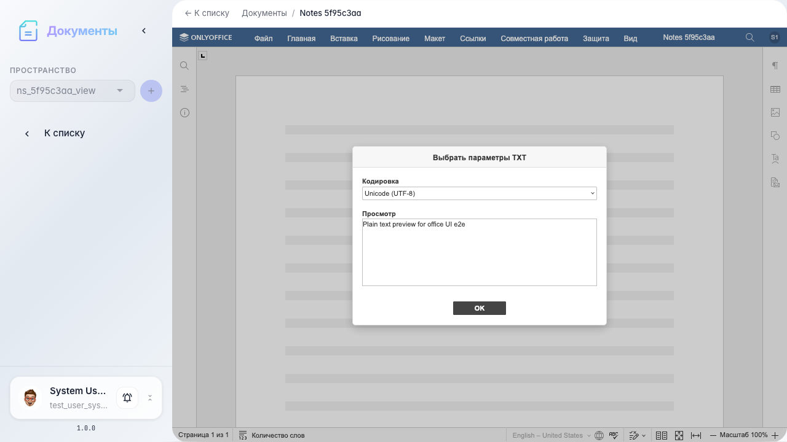
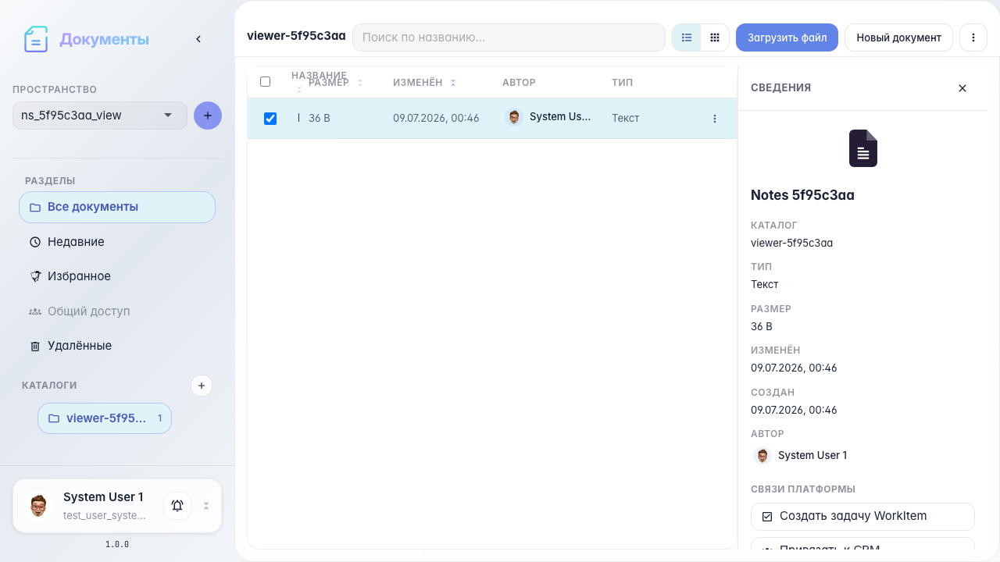

# Office: просмотр текстовых и других файлов

Inline-просмотр текста и возврат к списку документов.

## Шаг 1. Текстовый файл в каталоге

## Шаг 2. Текстовый просмотрщик открыт

## Шаг 3. Возврат к проводнику

## Шаг 4. Список документов после просмотра

