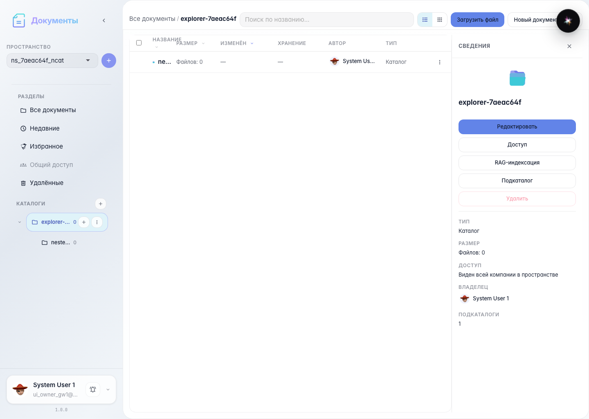
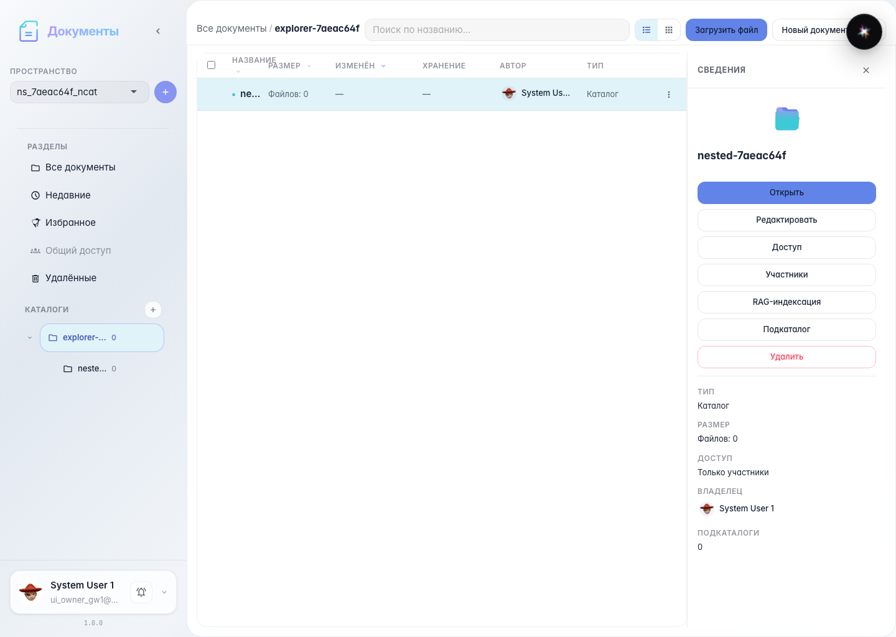
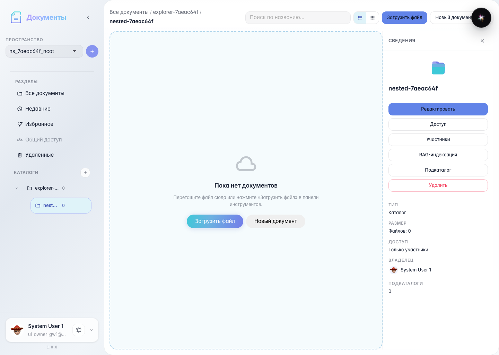

# Office: nested catalog in explorer table

A nested catalog in the current folder is a platform-file-row; double-click opens it.

## Step 1. Nested catalog as file row

## Step 2. Selected catalog details

## Step 3. Double-click opens nested catalog

