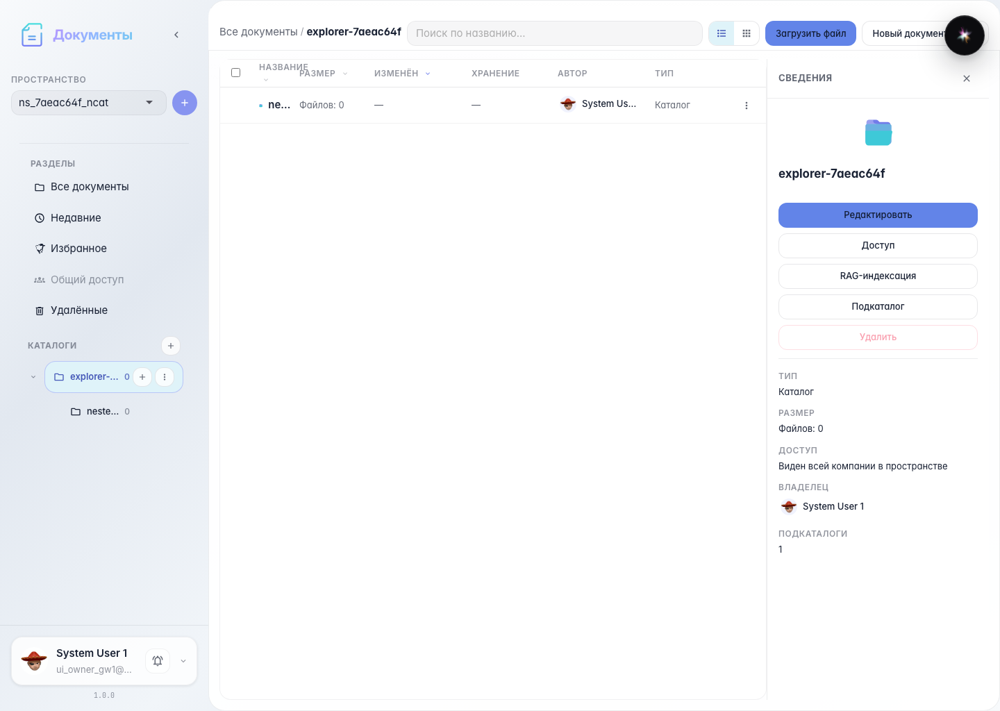
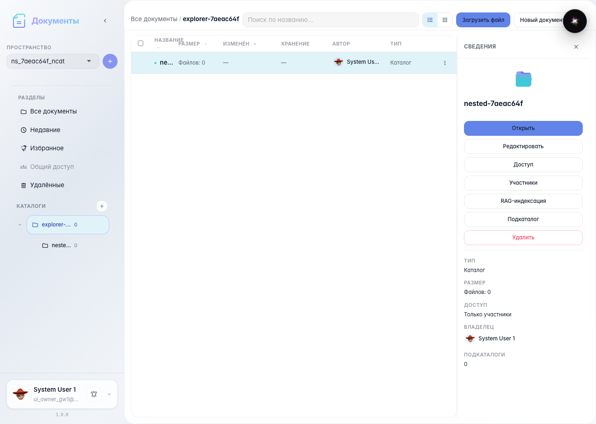
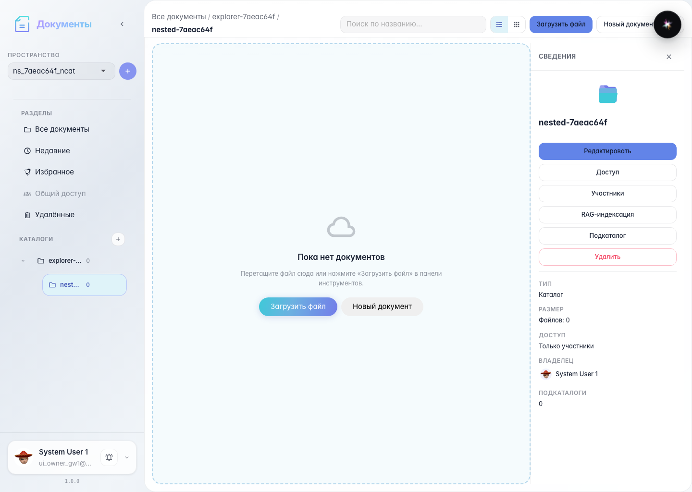

# Office: подкаталог в таблице проводника

Подкаталог в текущей папке — строка platform-file-row; двойной клик открывает каталог.

## Шаг 1. Подкаталог в таблице как строка файла

## Шаг 2. Сведения выбранного каталога

## Шаг 3. Двойной клик открывает подкаталог

