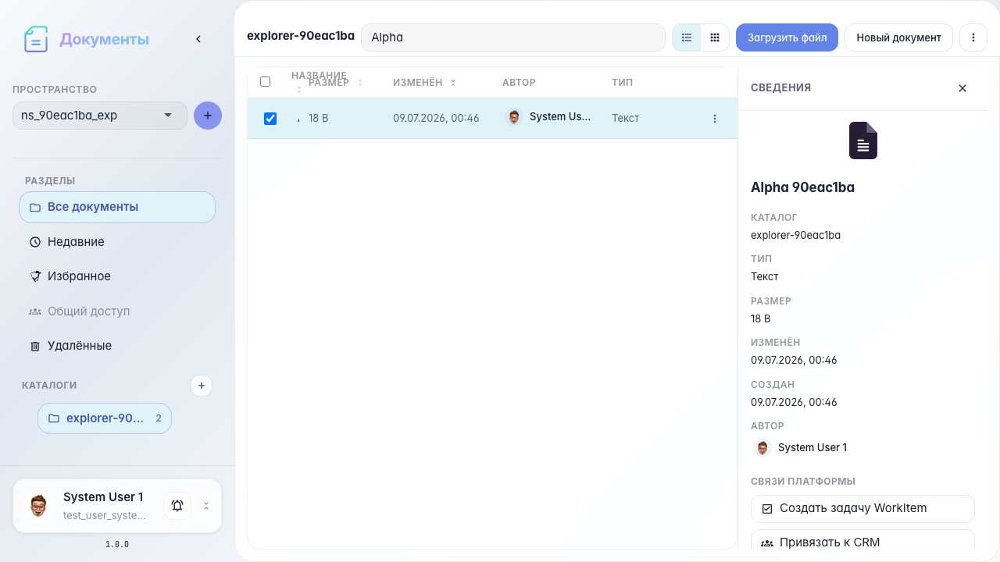

# Office: explorer search and organize

List and grid views, search, file selection, starred, and refresh.

## Step 1. Documents listed in catalog

## Step 2. List and grid toggle

## Step 3. Search by name

## Step 4. File details panel

## Step 5. Document starred

## Step 6. List refreshed

