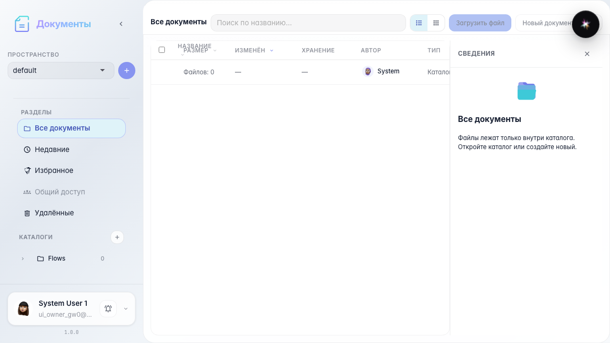
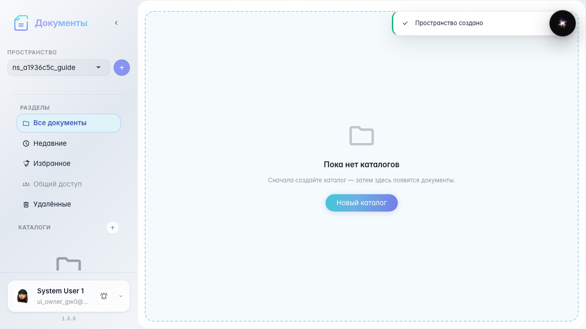
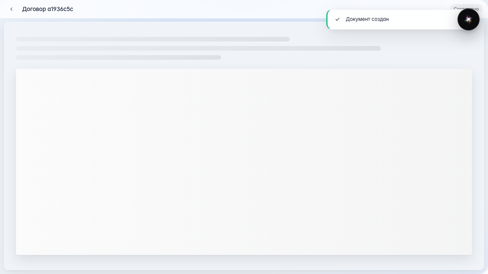

# Office: complete service guide

Complete Documents workflow: workspace, catalog, create a document, upload a file, and open it in the OnlyOffice editor.

## Step 1. Documents service opened

## Step 2. Workspace created

## Step 3. Document catalog created

## Step 4. Empty Word document created

