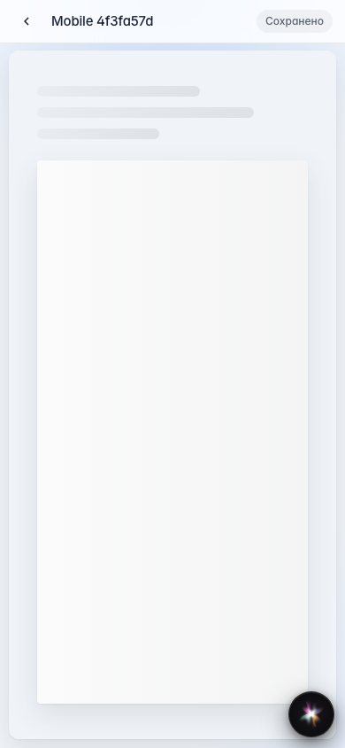

# Office: mobile documents workflow

Bottom nav, workspace and catalog pickers, editor without bottom navigation.

## Step 1. Mobile bottom navigation

## Step 2. Files and Recent tabs

## Step 3. Mobile catalog picker

## Step 4. Editor hides bottom nav

