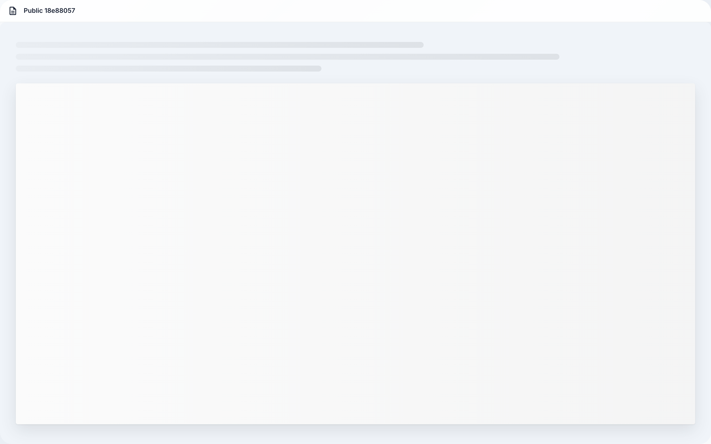
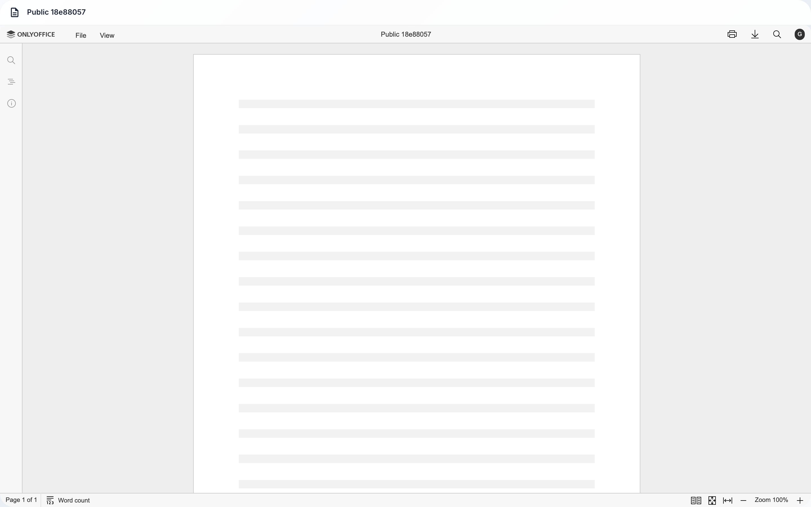
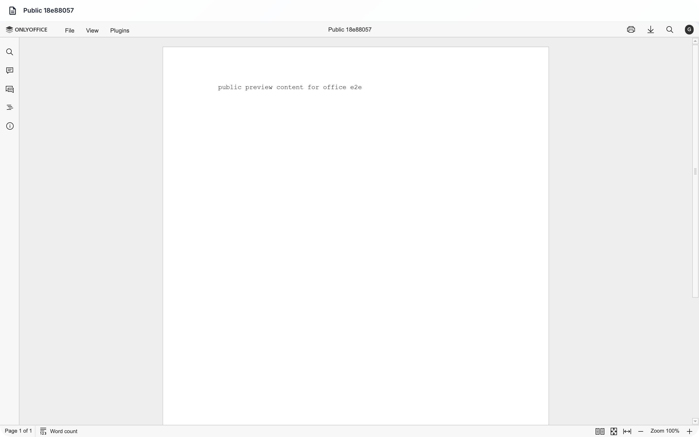

# Office: view a document via public link

**What for:** this guide shows how a guest without an account opens a document via a public link.

**Problems it solves:** you share a file with someone outside the company and want to see what they will get and what a wrong link does.

**Result:** the document opens in the browser without sign-in, and a broken link shows a clear error.

## Step 1. Open the public document link

Paste the received link into the browser address bar. No sign-in is needed — the preview page opens.

## Step 2. Check the document title in the header

The file name appears at the top of the page. This means the link works and the document is available to the guest.

## Step 3. Wait for the document content

The viewer loads the file text — wait until the content replaces the placeholder. The document is readable right on the page.

## Step 4. Check that a wrong link is rejected

**Result demonstration.** If the link is altered or expires, the page shows “Link not found” — a stranger cannot open the document.

**Summary.** You know what a guest sees via a public link: the document itself without sign-in, and a clear error for a bad link.

