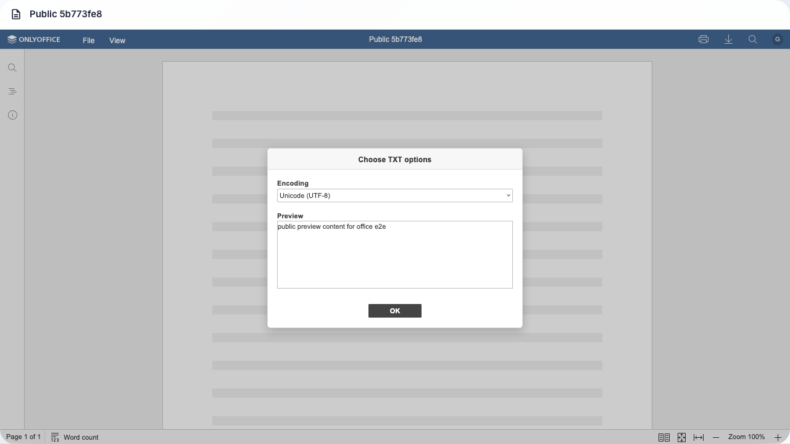
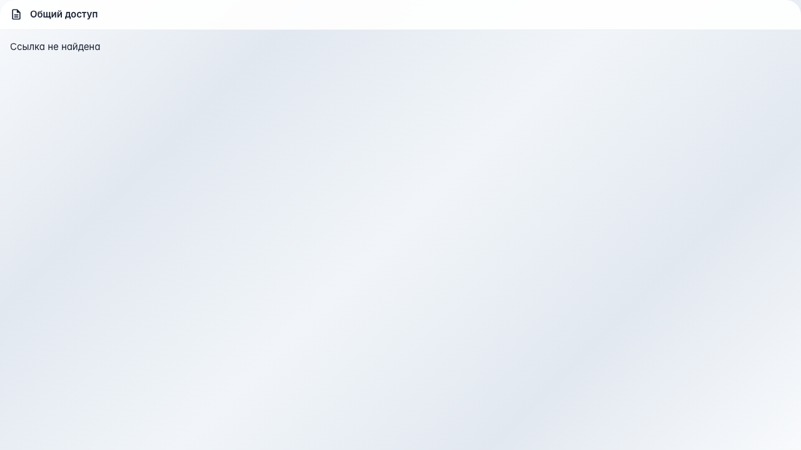

# Office: просмотр по публичной ссылке

Анонимный доступ к документу по токену /documents/p/:token и обработка неверной ссылки.

## Шаг 1. Страница предпросмотра открыта

## Шаг 2. Документ виден без авторизации

## Шаг 3. Просмотрщик документа загружен

## Шаг 4. Некорректная ссылка отклонена

