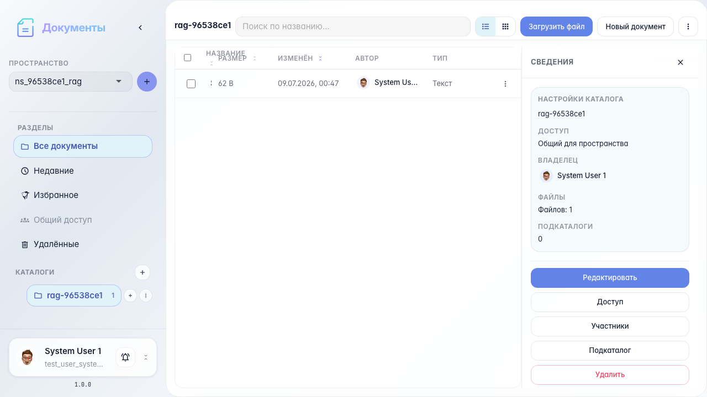
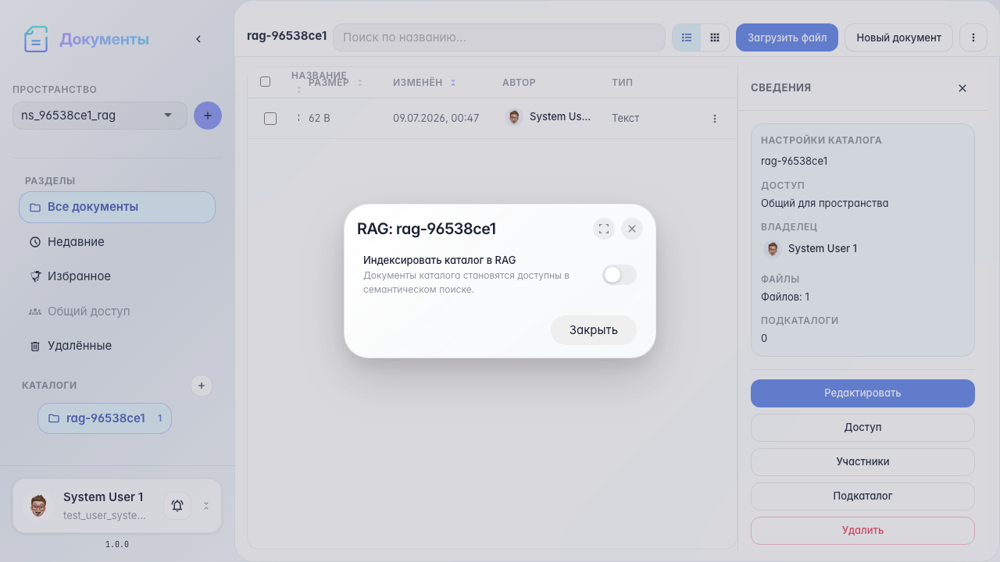
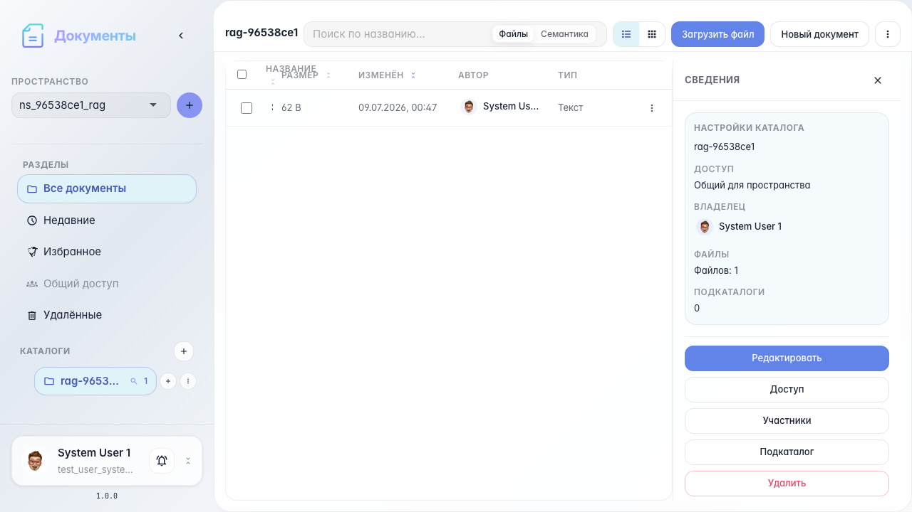
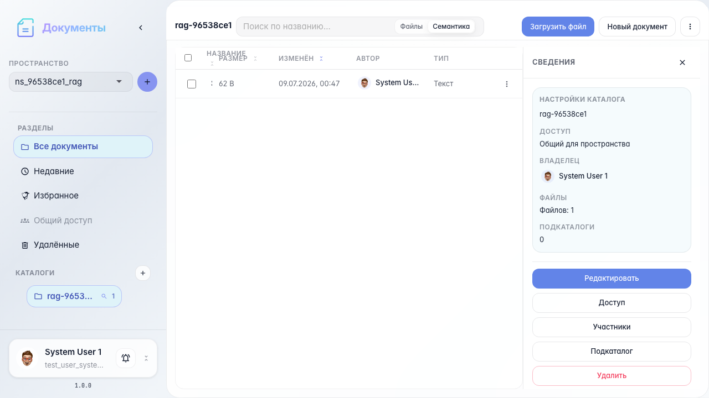
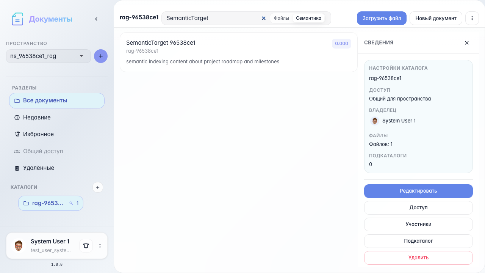
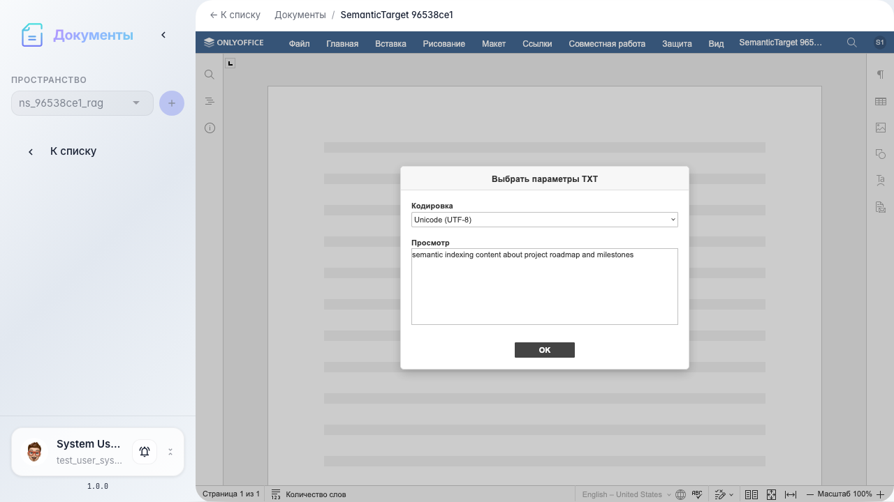

# Office: RAG indexing and semantic search

RAG modal, indexing status, semantic search, and opening a result.

## Step 1. Catalog with document for indexing

## Step 2. RAG indexing modal

## Step 3. Catalog indexing enabled

## Step 4. Semantic search mode

## Step 5. Semantic search results

## Step 6. Document opened from search result

