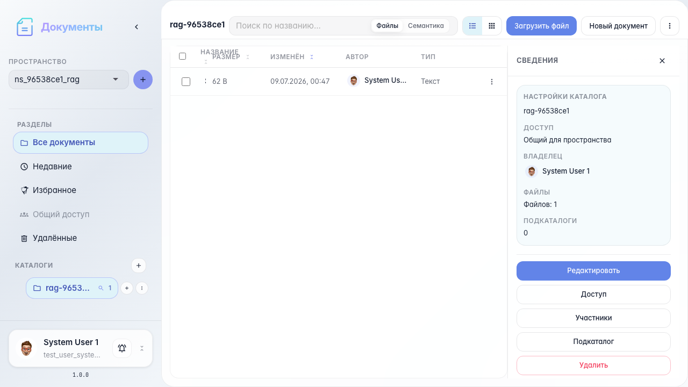
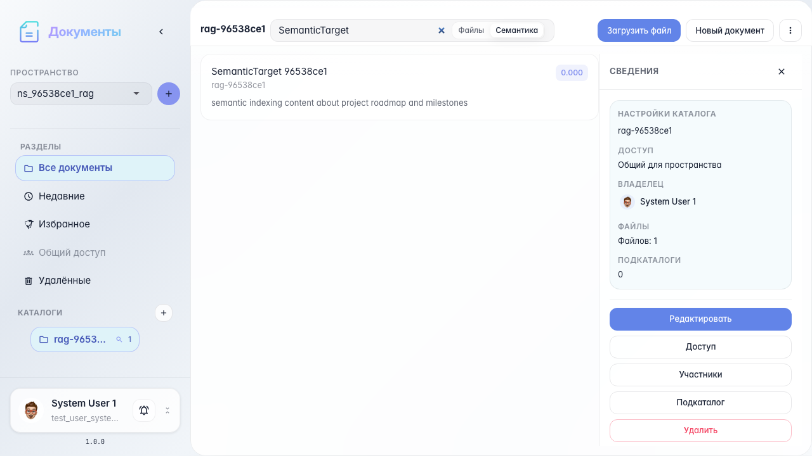

# Office: RAG-индексация и семантический поиск

Модалка RAG, статус индексации, семантический поиск и открытие результата.

## Шаг 1. Каталог с документом для индексации

## Шаг 2. Модалка RAG-индексации

## Шаг 3. Индексация каталога включена

## Шаг 4. Режим семантического поиска

## Шаг 5. Результаты семантического поиска

## Шаг 6. Документ открыт из результата поиска

