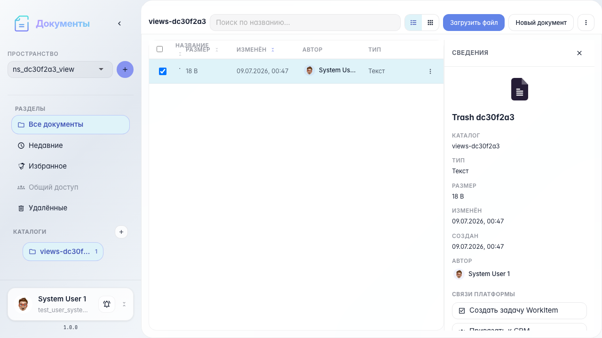
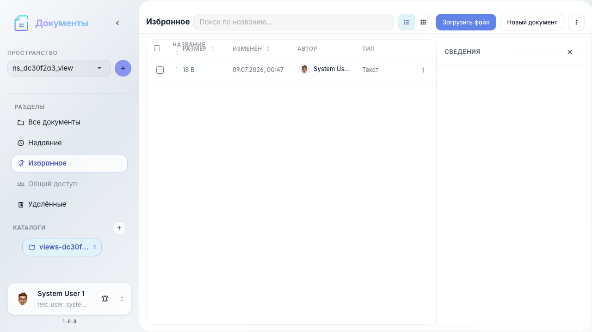
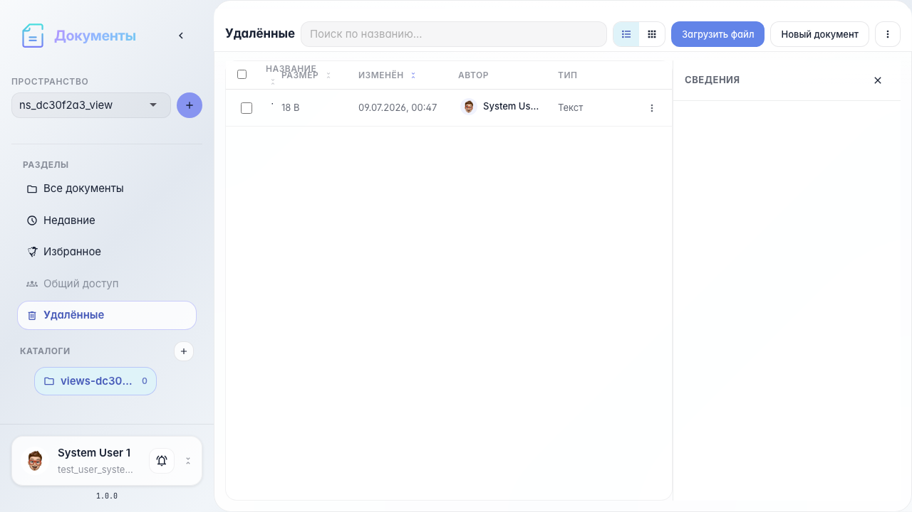

# Office: recent, starred, and trash

Nav-rail Recent/Starred/Deleted, restore and permanent delete.

## Step 1. Document in recent

## Step 2. Recent view

## Step 3. Starred view

## Step 4. Deleted view

## Step 5. Document restored

## Step 6. Document permanently deleted

