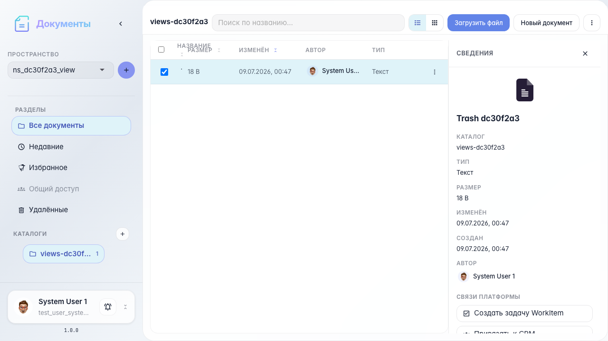
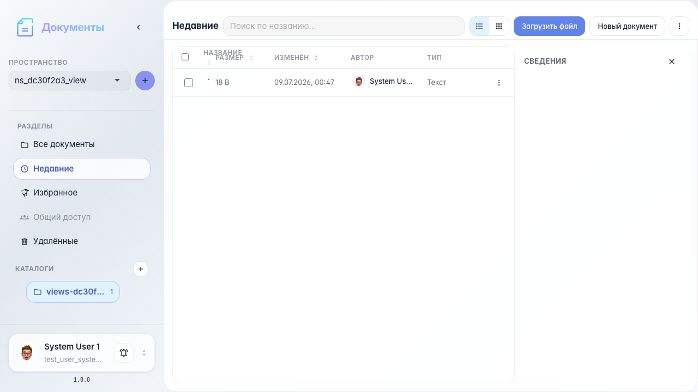
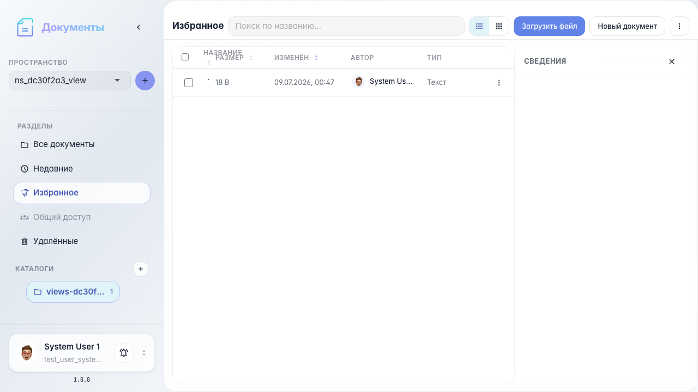
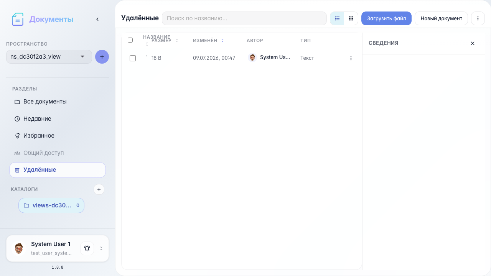
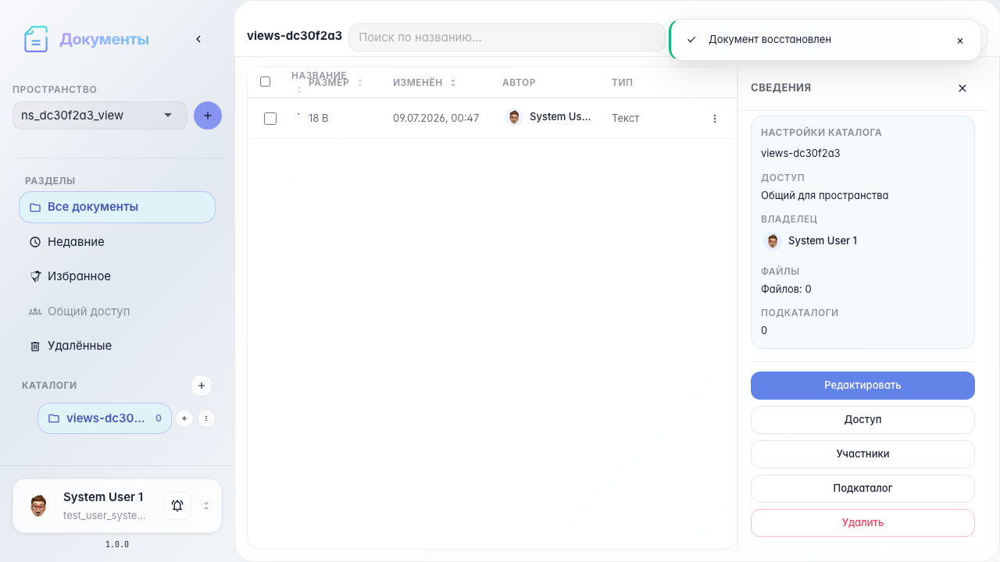
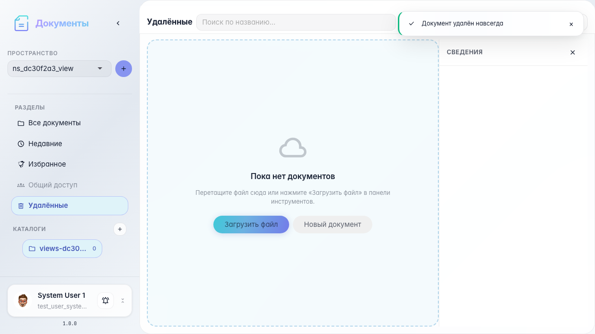

# Office: недавние, избранное и корзина

Nav-rail Recent/Starred/Deleted, восстановление и окончательное удаление.

## Шаг 1. Документ в недавних

## Шаг 2. Раздел «Недавние»

## Шаг 3. Раздел «Избранное»

## Шаг 4. Раздел «Удалённые»

## Шаг 5. Документ восстановлен

## Шаг 6. Документ удалён навсегда

