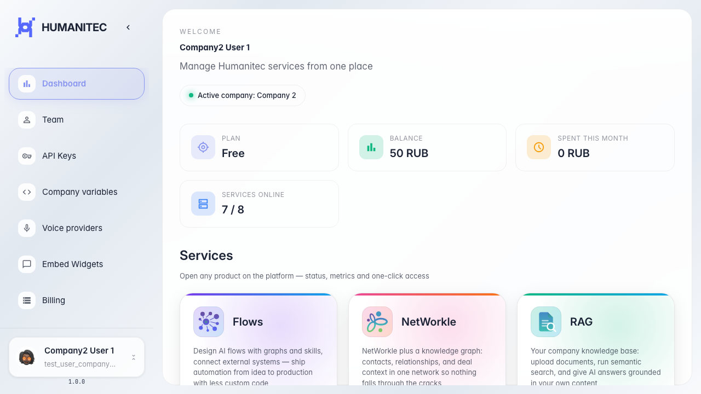
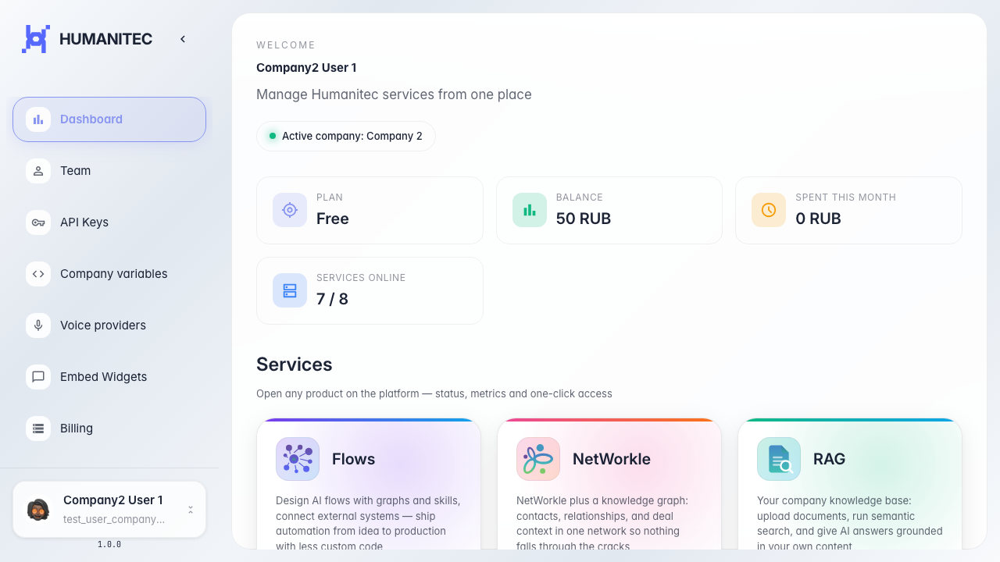
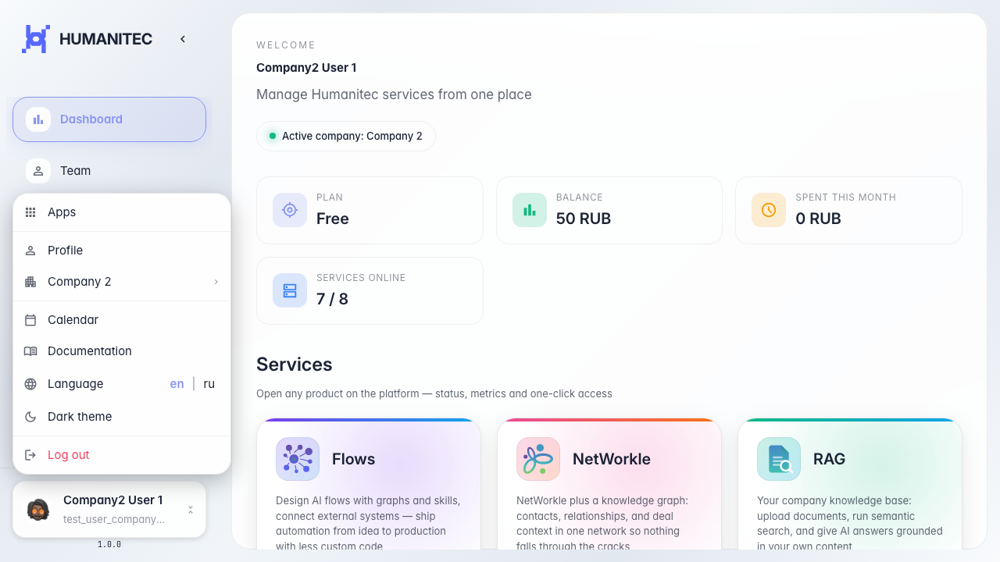
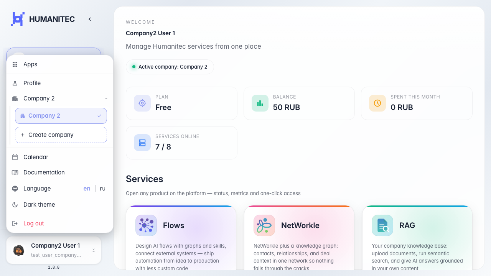
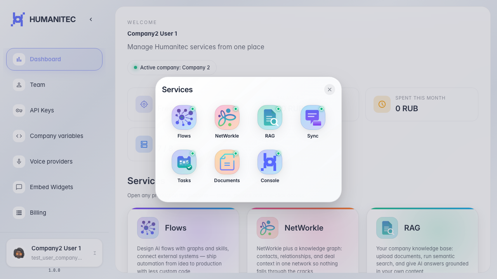
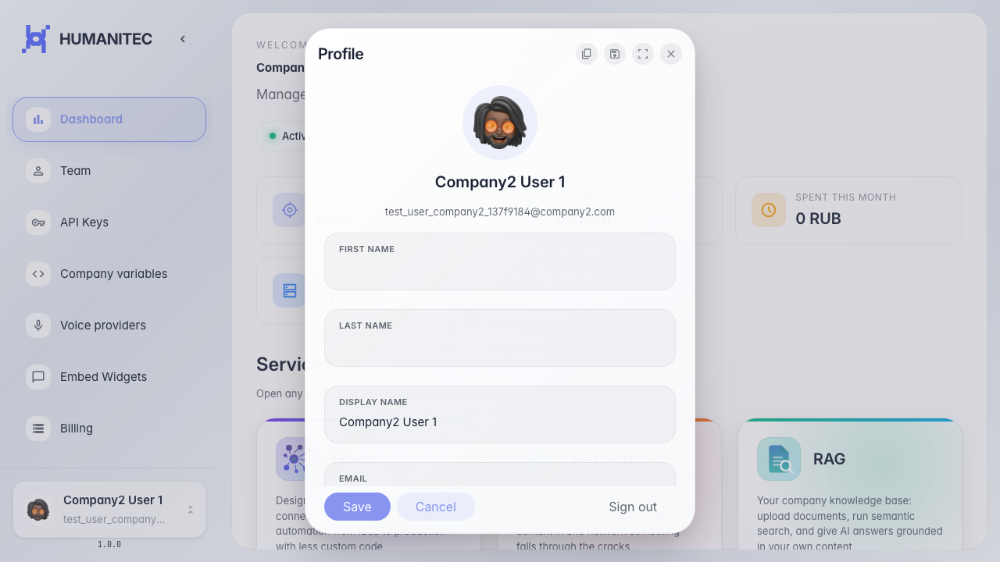
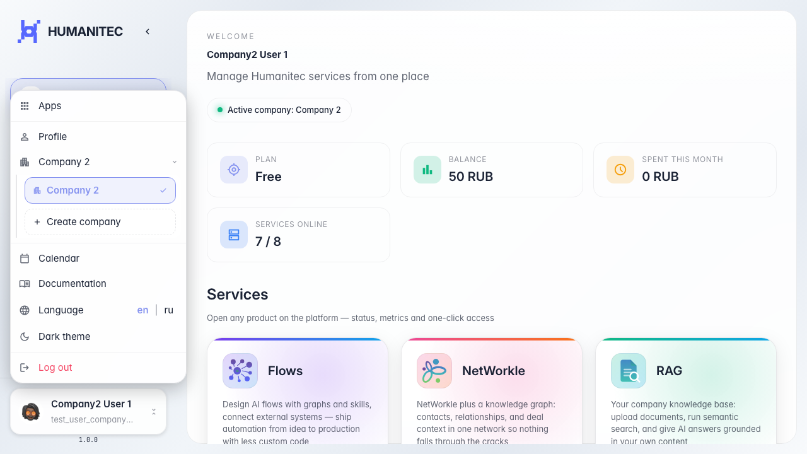
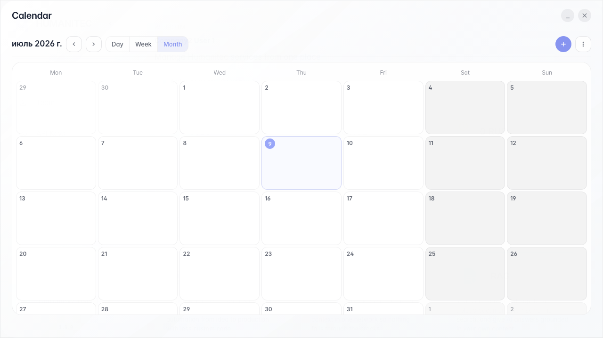

# Platform basics: entry, Dashboard, and user menu

A basic path for a new user: open the website, go to Dashboard, understand the service list, and inspect the user menu.

## Step 1. Open the company dashboard with the main services.

## Step 2. Dashboard shows the company's main services. System-only services are hidden from a regular company.

## Step 3. Open the user menu. It contains apps, profile, company, calendar, documentation, language, theme, and sign out.

## Step 4. The company row opens the company list. The checkmark shows the active company, and Create company starts a new company.

## Step 5. Apps opens the service launcher. It is a quick way to go to Flows, NetWorkle, RAG, Sync, or Documents.

## Step 6. Profile opens the user card with name, email, roles, and account actions.

## Step 7. The lower menu items: Documentation opens help, Language changes the locale, Theme switches appearance, and Logout signs out.

## Step 8. Calendar opens the fullscreen calendar. The modal stays inside the viewport and is ready to use.

