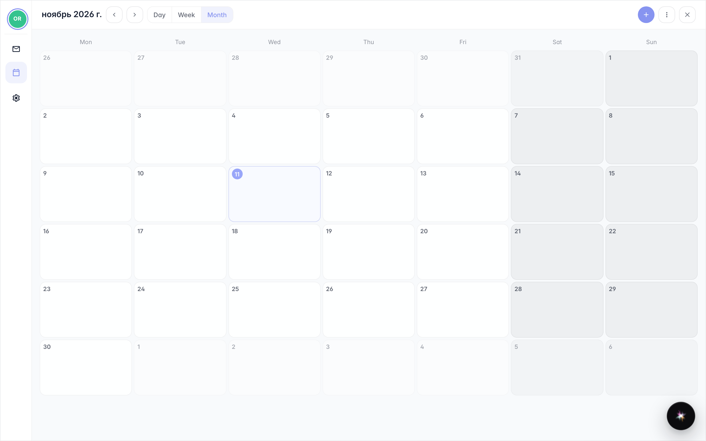

# The calendar from the user menu

**Purpose:** check appointments and deadlines without switching apps: the calendar opens from the user menu in one click.

**Problems solved:** while working you need a quick glance at the day or week without losing the page you are on.

**Result:** the calendar open over your work, ready to consult and close.

## Step 1. From the user menu open «Calendar»

Click your name at the top right, then «Calendar»: the window opens over your work without changing page. The current month shows the week's appointments.

## Step 2. Consult and close

**Result demonstration.** The calendar is shared with company mail: events from emails and appointments appear here. When done, close the window and get back to where you were.

**Summary.** Agenda always one click away, no extra windows.

